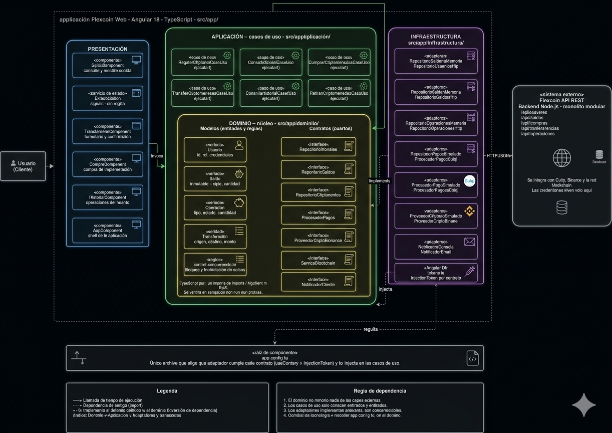
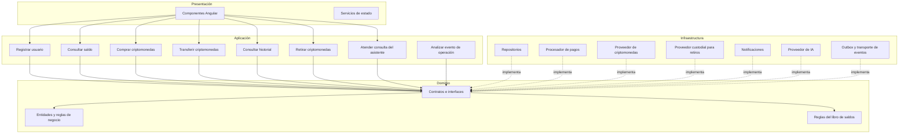

# Enfoque Arquitectónico

## Objetivo

Definir el enfoque arquitectónico que guía la organización interna del código y el control de dependencias del sistema QuillaCoin.

---

## Enfoque seleccionado

**Clean Architecture (Arquitectura Limpia).**

---

## Descripción aplicada a QuillaCoin

| Elemento | Descripción aplicada a QuillaCoin |
|----------|----------------------------------|
| Patrón / enfoque arquitectónico | Clean Architecture (Arquitectura Limpia). |
| Objetivo | Separar las reglas de negocio de los detalles tecnológicos y controlar las dependencias hacia el dominio. |
| ¿Qué problema resuelve? | Evita el acoplamiento entre la interfaz web, las reglas del negocio como el control de saldos y transferencias, y las tecnologías externas como base de datos, pasarela de pagos y proveedor de criptomonedas. |
| Capas definidas | Dominio, Aplicación, Infraestructura y Presentación. |
| Beneficios | Facilita el mantenimiento y las pruebas unitarias. Permite cambiar el proveedor de criptomonedas o la pasarela de pagos sin afectar las reglas del negocio. Mejora la organización y separación de responsabilidades del código. |

---

## Regla de dependencias

Las dependencias siempre apuntan hacia el dominio.

- La capa de **Presentación** depende de **Aplicación**.
- La capa de **Aplicación** depende de **Dominio**.
- La capa de **Infraestructura** implementa los contratos definidos en **Dominio**, pero no al revés.
- El **Dominio** no depende de ninguna otra capa.

Esto garantiza que las reglas del negocio, especialmente el control de concurrencia y la consistencia de saldos, permanezcan aisladas de los detalles tecnológicos.

---

## Capas y responsabilidades

| Capa | Responsabilidad en QuillaCoin |
|------|------------------------------|
| Presentación | Interfaz Angular y API REST. Recibe las peticiones del usuario y las responde. |
| Aplicación | Casos de uso como comprar criptomonedas, transferir saldos, consultar historial. Coordina las operaciones. |
| Dominio | Entidades como Usuario, Saldo y Operación; reglas como validar montos, origen/destino y fondos suficientes. |
| Infraestructura | Implementaciones concretas de repositorios, adaptadores de pasarela de pagos, proveedor de criptomonedas y notificaciones. |

---

## Módulos del sistema dentro del enfoque

| Módulo | Capa principal | Responsabilidad |
|--------|----------------|-----------------|
| Usuarios | Dominio y Aplicación | Registro, autenticación, roles. |
| Saldos | Dominio | Consulta y actualización de saldos. |
| Compras | Aplicación | Orquestar compra de criptomonedas. |
| Transferencias | Aplicación | Orquestar transferencias entre usuarios. |
| Operaciones | Aplicación | Historial, retiros y depósitos. |
| Asistencia conversacional | Aplicación e Infraestructura | Responder consultas acotadas; cualquier dato de cuenta se obtiene mediante operaciones autorizadas, nunca mediante acceso directo del modelo a la base. |
| Análisis de riesgo | Aplicación e Infraestructura | Consumir eventos del outbox fuera de la ruta HTTP y emitir alertas no vinculantes para revisión humana. |
| Integridad del libro | Dominio y persistencia | Las reglas de negocio se coordinan con una operación transaccional del almacenamiento autoritativo para evitar sobregiros y movimientos parciales. |

---

## Diagrama del enfoque arquitectónico

---

## Diagrama de dependencias en Mermaid

Las flechas continuas representan invocación en tiempo de ejecución. Las flechas discontinuas representan la implementación de contratos definidos en el dominio.

---

## Aplicación del enfoque en QuillaCoin

### Dominio aislado

El dominio contiene las reglas de negocio críticas, como validar transferencias y fondos. No depende de Angular, Express, la base de datos ni de proveedores concretos. La garantía de atomicidad y concurrencia se completa en el repositorio transaccional y el almacenamiento autoritativo; no se basa en bloqueos en memoria.

### Casos de uso en la capa de aplicación

Los casos de uso orquestan las operaciones del sistema. Por ejemplo, `ComprarCriptomonedasCasoUso` coordina el repositorio de saldos, el procesador de pagos, el proveedor de criptomonedas y el notificador. Pero solo conoce las interfaces, no las implementaciones concretas.

### Adaptadores intercambiables en infraestructura

Los adaptadores implementan contratos de aplicación para proveedores externos. La pasarela peruana y el proveedor custodial aún no se han seleccionado; durante la fase académica ambos se simulan. Cambiar de proveedor implica agregar un adaptador, no modificar las reglas del libro.

### Raíz de composición

El archivo `app.config.ts` es el único lugar donde se decide qué adaptador cumple cada contrato. Usa `useFactory` e `InjectionToken` para inyectar las implementaciones en los casos de uso.

---

## Beneficios del enfoque en QuillaCoin

- **Pruebas sin infraestructura.** El dominio puede probarse sin navegador, sin base de datos y sin servicios externos.
- **Cambio de proveedor sin dolor.** Sustituir la pasarela o el proveedor custodial implica escribir un adaptador nuevo, no modificar la lógica de compras o del libro.
- **Consistencia controlada.** Transferencias internas aplican débito y crédito juntos en el libro autoritativo; no llaman al proveedor ni a la blockchain. Los retiros externos son otro flujo.
- **IA fuera de la ruta financiera crítica.** La API confirma la transferencia y guarda el evento en el outbox; un worker analiza después y genera una sugerencia. Una falla del modelo no revierte ni demora el movimiento confirmado.
- **Límites de autoridad y privacidad.** El chat no ejecuta transacciones; el análisis no bloquea cuentas. El servidor aplica permisos y minimiza el contexto enviado a servicios externos.
- **Mantenibilidad real.** Cada capa tiene una responsabilidad clara, lo que reduce el acoplamiento y facilita la evolución del sistema.