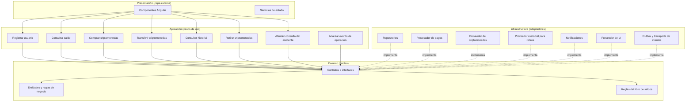

# Estilo Arquitectónico

## Objetivo

Definir el estilo arquitectónico del sistema QuillaCoin y representar su estructura global mediante un diagrama que muestre los principales componentes y sus relaciones.

---

## Estilo seleccionado

**Monolito modular con arquitectura en capas y worker asíncrono complementario.**

La API principal se organiza en módulos independientes y capas bien definidas. Un proceso worker ejecuta análisis de riesgo en segundo plano desde eventos durables; comparte el modelo y los contratos del backend, pero puede desplegarse y escalarse independientemente. No convierte los módulos de negocio en microservicios.

---

## Justificación

| Driver | Cómo lo responde el estilo |
|--------|----------------------------|
| DA01 Consistencia | El control de concurrencia se centraliza en un módulo específico dentro del monolito, evitando conflictos entre operaciones. |
| DA02 Rendimiento | La separación por capas permite incorporar caché para consultas frecuentes de saldos. |
| DA03 Seguridad | La autenticación y autorización se gestionan en la capa de presentación y en los servicios de usuarios. |
| DA04 Servicios externos | Los adaptadores para la pasarela de pagos y el proveedor de criptomonedas se aíslan en la capa de datos e infraestructura. |
| DA08 Análisis asíncrono | Un outbox y un worker aíslan la latencia o falla del proveedor de IA de las operaciones financieras confirmadas. |
| DA09 Uso responsable de IA | El chat consulta solo datos autorizados y el análisis genera alertas no vinculantes; no ejecuta movimientos ni bloquea cuentas. |
| DA06 Mantenibilidad | La modularidad y las capas permiten modificar una parte del sistema sin afectar otras. |

---

## Capas del sistema

| Capa | Responsabilidad |
|------|-----------------|
| Presentación | Recibe las peticiones HTTP, valida los datos de entrada y devuelve respuestas JSON. |
| Lógica de negocio | Aplica las reglas del sistema, coordina los módulos y controla la concurrencia. |
| Datos | Gestiona la persistencia y las consultas a la base de datos. |

---

## Módulos del sistema

| Módulo | Responsabilidad |
|--------|-----------------|
| 1. Usuarios | Registro, autenticación y gestión de roles. |
| 2. Saldos y libro | Mantiene los movimientos internos autoritativos y expone saldos derivados; el caché solo acelera lecturas. |
| 3. Compras | Órdenes de compra y confirmación con la pasarela de pagos. |
| 4. Transferencias | Movimientos contables atómicos entre usuarios; no llaman al proveedor ni a la blockchain. |
| 5. Operaciones | Historial, retiros externos con estados y depósitos simulados en la primera fase. |
| 6. Pagos | Cobro mediante la pasarela de pago. |
| 7. Notificaciones | Avisos al usuario sobre el estado de sus operaciones. |
| 8. Integridad transaccional | Garantías de concurrencia aplicadas al libro por el almacenamiento autoritativo; no es un bloqueo en memoria. |
| 9. Asistencia conversacional | Chat servido por la API; responde preguntas y consulta datos del usuario solo mediante operaciones autorizadas. No ejecuta operaciones financieras. |
| 10. Análisis de riesgo | Worker separado que consume eventos durables y produce sugerencias/alertas para revisión administrativa; no tiene autoridad para bloquear. |

---

## Sistemas externos

| Sistema | Propósito |
|---------|-----------|
| Pasarela de pagos | Procesar pagos para la compra de criptomonedas. |
| Proveedor custodial de criptomonedas | Mantener fondos agrupados y procesar adquisiciones/retiros externos; en la fase académica se usa un adaptador simulado. |
| Red blockchain | Liquidar retiros externos bajo responsabilidad del proveedor cuando corresponda; QuillaCoin no se integra directamente en la fase inicial. |
| Servicio de notificaciones | Informar al usuario sobre el estado de sus operaciones. |
| Proveedor de IA | Producir respuestas o evaluaciones a través de un adaptador; proveedor por seleccionar y sujeto a minimización de datos. |

---

## Relación con el enfoque arquitectónico

La arquitectura en capas se complementa con el enfoque **Clean Architecture**, que organiza internamente cada capa en Dominio, Aplicación, Infraestructura y Presentación, con dependencias siempre apuntando hacia el dominio.

Esto significa que:

- La capa de **Presentación** del estilo corresponde a la capa de **Presentación + Infraestructura** del enfoque.
- La capa de **Lógica de negocio** del estilo corresponde a las capas de **Aplicación + Dominio** del enfoque.
- La capa de **Datos** del estilo corresponde a la capa de **Infraestructura** del enfoque.

El detalle completo del enfoque se documenta en `arquitectura/enfoque/enfoque-arquitectonico.md`.

---

---

## Flujo de dependencias

