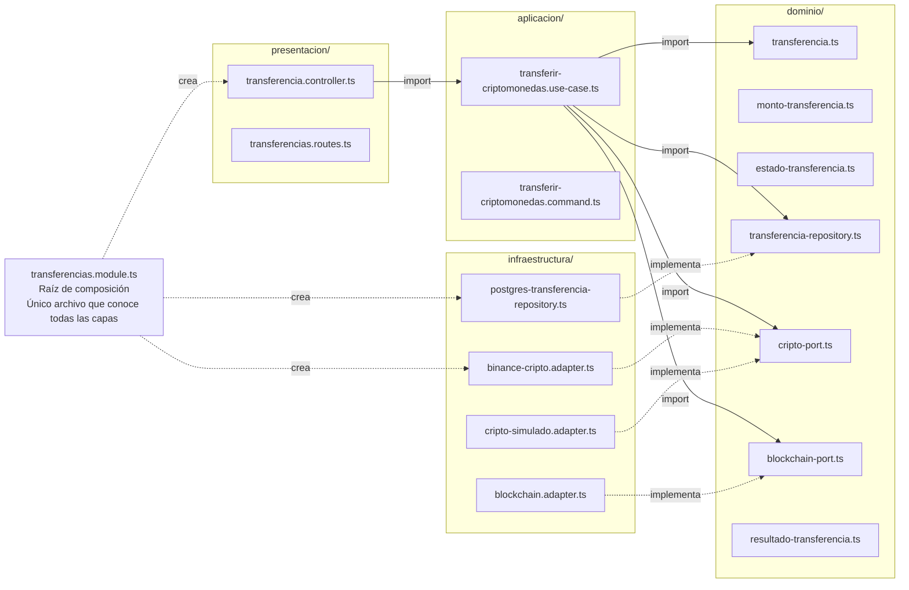
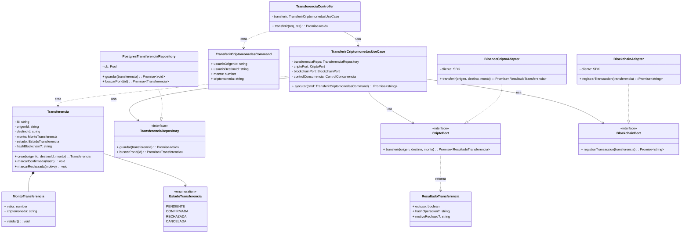
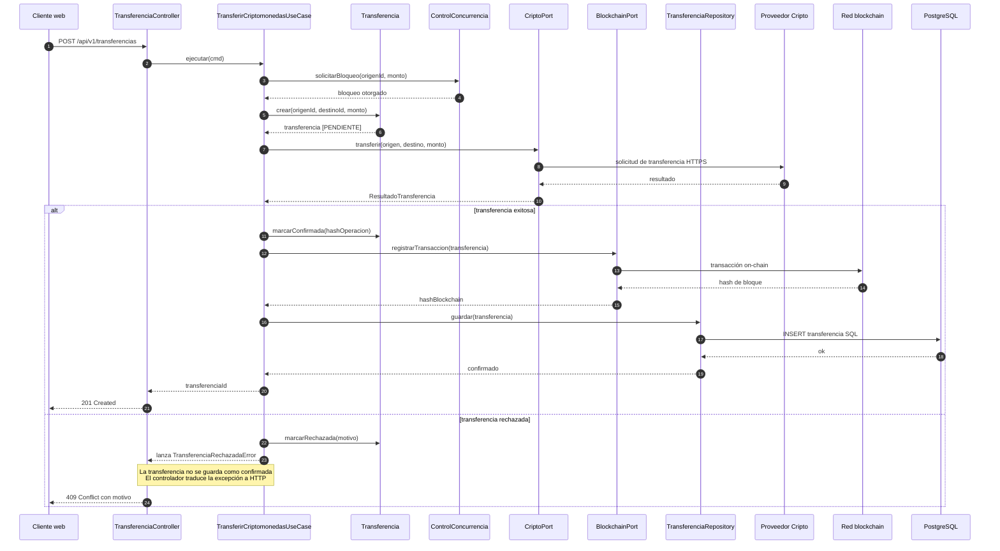

# Diseño interno de módulos

> **Proyecto:** Flexcoin · **Backend:** Node.js + TypeScript · **Módulo de referencia:** Transferencias  
> **Enfoque arquitectónico:** Clean Architecture dentro de cada módulo del monolito modular  
> **Nivel C4:** 4 - Código · **Versión:** 1.0

---

## 1. Propósito

Este documento describe cómo se organiza el código dentro de un módulo del backend. Tiene tres objetivos:

- que todos los módulos se construyan con la misma estructura;
- que las reglas de negocio queden aisladas de la tecnología;
- que cualquier integrante del equipo sepa dónde va cada archivo y de qué puede depender.

Se toma el módulo **Transferencias** como referencia porque concentra las reglas más críticas del sistema (control de concurrencia y consistencia de saldos).

---

## 2. Estructura de carpetas

```text
src/
└── modules/
    └── transferencias/
        ├── dominio/
        │   ├── transferencia.ts                 Entidad Transferencia y sus reglas
        │   ├── monto-transferencia.ts           Objeto de valor MontoTransferencia
        │   ├── estado-transferencia.ts          Enumeración EstadoTransferencia
        │   ├── transferencia-repository.ts      Interfaz (puerto) de persistencia
        │   ├── cripto-port.ts                   Interfaz (puerto) del proveedor de criptomonedas
        │   ├── blockchain-port.ts               Interfaz (puerto) de la red blockchain
        │   └── resultado-transferencia.ts       DTO de respuesta de la operación
        ├── aplicacion/
        │   ├── transferir-criptomonedas.use-case.ts   Caso de uso TransferirCriptomonedas
        │   └── transferir-criptomonedas.command.ts    Datos de entrada del caso de uso
        ├── infraestructura/
        │   ├── postgres-transferencia-repository.ts   Implementación con PostgreSQL
        │   ├── binance-cripto.adapter.ts              Implementación con Binance
        │   ├── cripto-simulado.adapter.ts             Implementación simulada
        │   └── blockchain.adapter.ts                  Implementación con la red blockchain
        ├── presentacion/
        │   ├── transferencia.controller.ts            Traduce HTTP a caso de uso
        │   └── transferencias.routes.ts               Rutas /api/v1/transferencias
        ├── transferencias.module.ts                   Raíz de composición del módulo
        └── index.ts                                   API pública del módulo
```

| Archivo | Capa | Responsabilidad | Importa de |
|---|---|---|---|
| `transferencia.ts` | Dominio | Crear transferencias válidas, validar fondos, cambiar de estado | Solo dominio |
| `monto-transferencia.ts` | Dominio | Representar el monto y su criptomoneda | Nada |
| `estado-transferencia.ts` | Dominio | Definir los estados posibles de la transferencia | Nada |
| `transferencia-repository.ts` | Dominio | Declarar **qué** operaciones de persistencia necesita el módulo | `transferencia.ts` |
| `cripto-port.ts` | Dominio | Declarar **qué** necesita el módulo del proveedor de criptomonedas | `resultado-transferencia.ts` |
| `blockchain-port.ts` | Dominio | Declarar **qué** necesita el módulo de la red blockchain | `resultado-transferencia.ts` |
| `resultado-transferencia.ts` | Dominio | Estructura del resultado de una operación externa | Nada |
| `transferir-criptomonedas.use-case.ts` | Aplicación | Coordinar los pasos de la transferencia | Dominio |
| `transferir-criptomonedas.command.ts` | Aplicación | Datos de entrada validados del caso de uso | Nada |
| `postgres-transferencia-repository.ts` | Infraestructura | Guardar y leer transferencias en PostgreSQL | Dominio + driver de BD |
| `binance-cripto.adapter.ts` | Infraestructura | Traducir `transferir()` a la API de Binance | Dominio + SDK |
| `cripto-simulado.adapter.ts` | Infraestructura | Simular el proveedor de criptomonedas en pruebas | Dominio |
| `blockchain.adapter.ts` | Infraestructura | Enviar la transacción a la red blockchain | Dominio + SDK |
| `transferencia.controller.ts` | Presentación | Leer la petición HTTP, invocar el caso de uso y responder | Aplicación |
| `transferencias.routes.ts` | Presentación | Registrar las rutas en Express | Presentación |
| `transferencias.module.ts` | Composición | Crear las instancias concretas e inyectarlas | Todas las capas |
| `index.ts` | Composición | Exponer solo lo que otros módulos pueden usar | `transferencias.module.ts` |

---

## 3. Diagrama de paquetes



**Regla de dependencia:** el código solo puede importar hacia el centro (dominio). El dominio no conoce Express, PostgreSQL, Binance ni la blockchain.

---

## 4. Capas del módulo y regla de dependencia

| Capa | Contiene | Responsabilidad | Puede depender de | **No** puede depender de |
|---|---|---|---|---|
| **Dominio** | Entidades, objetos de valor, enumeraciones, interfaces (puertos) | Reglas de negocio que serían ciertas con cualquier tecnología | Nada externo | Aplicación, infraestructura, presentación, Express, ORM, SDK |
| **Aplicación** | Casos de uso, comandos | Orquestar el flujo: qué paso va primero y qué hacer si falla | Dominio | Infraestructura, presentación, Express, ORM |
| **Infraestructura** | Repositorios concretos, adaptadores de servicios externos | Implementar las interfaces del dominio con una tecnología | Dominio, librerías externas | Aplicación, presentación |
| **Presentación** | Controladores, rutas | Traducir HTTP a llamadas del caso de uso y viceversa | Aplicación | Infraestructura, base de datos |
| **Composición** | `transferencias.module.ts` | Elegir implementaciones concretas y conectarlas | Todas | - |

> **Cómo comprobarlo en el código:** basta revisar los `import` de `dominio/`. Si aparece `express`, `pg`, un SDK de criptomonedas o cualquier archivo de `infraestructura/`, la regla se rompió.

---

## 5. Diagrama de clases



### 5.1 Notación UML utilizada

| Símbolo | Significado | Ejemplo en el diagrama |
|---|---|---|
| Línea continua con flecha abierta | Asociación: la clase guarda una referencia a la otra | `TransferirCriptomonedasUseCase` → `TransferenciaRepository` |
| Línea discontinua con flecha abierta | Dependencia: la usa o la crea, pero no la guarda | `TransferenciaController` «crea» `TransferirCriptomonedasCommand` |
| Línea discontinua con triángulo hueco | Realización: implementa una interfaz | `PostgresTransferenciaRepository` ▷ `TransferenciaRepository` |
| Rombo relleno | Composición: la parte no existe sin el todo | `Transferencia` ◆ `MontoTransferencia` |
| Nombre en cursiva + «interface» | Interfaz (contrato sin implementación) | `TransferenciaRepository`, `CriptoPort` |
| `-` / `+` | Privado / público | `- estado`, `+ marcarConfirmada()` |

---

## 6. Flujo de ejecución: transferir criptomonedas



| Paso | Origen a destino | Acción | Capa |
|---|---|---|---|
| 1 | Cliente web a `TransferenciaController` | `POST /api/v1/transferencias` con origen, destino, monto y criptomoneda | Presentación |
| 2 | `TransferenciaController` a `TransferirCriptomonedasUseCase` | `ejecutar(cmd)` | Presentación a Aplicación |
| 3 | `TransferirCriptomonedasUseCase` a `ControlConcurrencia` | Solicitar bloqueo del saldo de origen | Aplicación a Dominio |
| 4 | `TransferirCriptomonedasUseCase` a `Transferencia` | `crear(origen, destino, monto)`, estado PENDIENTE | Aplicación a Dominio |
| 5 | `TransferirCriptomonedasUseCase` a `CriptoPort` | `transferir(origen, destino, monto)` | Aplicación a Dominio (interfaz) |
| 6 | `BinanceCriptoAdapter` a proveedor externo | Solicitud de transferencia por HTTPS | Infraestructura a externo |
| 7 | `TransferirCriptomonedasUseCase` a `Transferencia` | Si fue exitosa: `marcarConfirmada(hash)` | Aplicación a Dominio |
| 8 | `TransferirCriptomonedasUseCase` a `BlockchainPort` | `registrarTransaccion(transferencia)` | Aplicación a Dominio (interfaz) |
| 9 | `BlockchainAdapter` a red blockchain | Envío de la transacción on-chain | Infraestructura a externo |
| 10 | `TransferirCriptomonedasUseCase` a `TransferenciaRepository` | `guardar(transferencia)` | Aplicación a Dominio (interfaz) |
| 11 | `PostgresTransferenciaRepository` a PostgreSQL | `INSERT` de la transferencia | Infraestructura a BD |
| 12 | `TransferenciaController` a Cliente web | `201 Created` con `transferenciaId` | Presentación |
| 13 | Alternativa | Si la transferencia es rechazada: no se guarda como confirmada y se responde `409 Conflict` | Aplicación a Presentación |

---

## 7. Código de referencia

### 7.1 Dominio · entidad e interfaces

```ts
// dominio/transferencia.ts
import { MontoTransferencia } from './monto-transferencia';
import { EstadoTransferencia } from './estado-transferencia';
import { ReglaNegocioError } from '../../../shared/errores';

export class Transferencia {
  private constructor(
    readonly id: string,
    readonly origenId: string,
    readonly destinoId: string,
    readonly monto: MontoTransferencia,
    private estado: EstadoTransferencia,
    private hashBlockchain?: string,
  ) {}

  static crear(origenId: string, destinoId: string, monto: MontoTransferencia): Transferencia {
    if (!origenId || !destinoId) throw new ReglaNegocioError('RN-01: origen y destino son obligatorios');
    if (origenId === destinoId) throw new ReglaNegocioError('RN-02: no se puede transferir al mismo usuario');
    monto.validar();
    return new Transferencia(crypto.randomUUID(), origenId, destinoId, monto, EstadoTransferencia.PENDIENTE);
  }

  marcarConfirmada(hash: string): void {
    if (this.estado !== EstadoTransferencia.PENDIENTE) {
      throw new ReglaNegocioError('RN-03: solo una transferencia pendiente puede confirmarse');
    }
    this.estado = EstadoTransferencia.CONFIRMADA;
    this.hashBlockchain = hash;
  }

  marcarRechazada(motivo: string): void {
    if (this.estado !== EstadoTransferencia.PENDIENTE) {
      throw new ReglaNegocioError('RN-04: solo una transferencia pendiente puede rechazarse');
    }
    this.estado = EstadoTransferencia.RECHAZADA;
  }
}
```

```ts
// dominio/transferencia-repository.ts
import { Transferencia } from './transferencia';

export interface TransferenciaRepository {
  guardar(transferencia: Transferencia): Promise<void>;
  buscarPorId(id: string): Promise<Transferencia | null>;
}
```

```ts
// dominio/cripto-port.ts
import { ResultadoTransferencia } from './resultado-transferencia';

export interface CriptoPort {
  transferir(origenId: string, destinoId: string, monto: number): Promise<ResultadoTransferencia>;
}
```

```ts
// dominio/blockchain-port.ts
import { Transferencia } from './transferencia';

export interface BlockchainPort {
  registrarTransaccion(transferencia: Transferencia): Promise<string>;
}
```

### 7.2 Aplicación · caso de uso

```ts
// aplicacion/transferir-criptomonedas.use-case.ts
import { Transferencia } from '../dominio/transferencia';
import { MontoTransferencia } from '../dominio/monto-transferencia';
import { TransferenciaRepository } from '../dominio/transferencia-repository';
import { CriptoPort } from '../dominio/cripto-port';
import { BlockchainPort } from '../dominio/blockchain-port';
import { TransferirCriptomonedasCommand } from './transferir-criptomonedas.command';
import { TransferenciaRechazadaError } from '../../../shared/errores';

export class TransferirCriptomonedasUseCase {
  constructor(
    private readonly transferenciaRepo: TransferenciaRepository,
    private readonly criptoPort: CriptoPort,
    private readonly blockchainPort: BlockchainPort,
    private readonly controlConcurrencia: ControlConcurrencia,
  ) {}

  async ejecutar(cmd: TransferirCriptomonedasCommand): Promise<string> {
    const monto = new MontoTransferencia(cmd.monto, cmd.criptomoneda);
    const transferencia = Transferencia.crear(cmd.usuarioOrigenId, cmd.usuarioDestinoId, monto);

    await this.controlConcurrencia.solicitarBloqueo(cmd.usuarioOrigenId, cmd.monto);

    const resultado = await this.criptoPort.transferir(cmd.usuarioOrigenId, cmd.usuarioDestinoId, cmd.monto);
    if (!resultado.exitoso) {
      transferencia.marcarRechazada(resultado.motivoRechazo ?? 'Sin detalle');
      throw new TransferenciaRechazadaError(resultado.motivoRechazo);
    }

    const hash = await this.blockchainPort.registrarTransaccion(transferencia);
    transferencia.marcarConfirmada(hash);

    await this.transferenciaRepo.guardar(transferencia);
    return transferencia.id;
  }
}
```

> El bloqueo del saldo de origen debe solicitarse antes de ejecutar la transferencia y liberarse al finalizar, tanto en el camino exitoso como en el fallo. Se omite el `finally` para mantener el ejemplo corto.

### 7.3 Infraestructura · adaptador

```ts
// infraestructura/binance-cripto.adapter.ts
import { CriptoPort } from '../dominio/cripto-port';
import { ResultadoTransferencia } from '../dominio/resultado-transferencia';

export class BinanceCriptoAdapter implements CriptoPort {
  constructor(private readonly cliente: any) {}

  async transferir(origenId: string, destinoId: string, monto: number): Promise<ResultadoTransferencia> {
    try {
      const op = await this.cliente.transferir({ origenId, destinoId, monto });
      return { exitoso: true, hashOperacion: op.hash };
    } catch (e) {
      return { exitoso: false, motivoRechazo: (e as Error).message };
    }
  }
}
```

### 7.4 Presentación · controlador

```ts
// presentacion/transferencia.controller.ts
import { Request, Response } from 'express';
import { TransferirCriptomonedasUseCase } from '../aplicacion/transferir-criptomonedas.use-case';

export class TransferenciaController {
  constructor(private readonly transferirCripto: TransferirCriptomonedasUseCase) {}

  transferir = async (req: Request, res: Response): Promise<void> => {
    const id = await this.transferirCripto.ejecutar({
      usuarioOrigenId: req.user.id,       // lo agrega el middleware JWT; no viene del body
      usuarioDestinoId: req.body.destinoId,
      monto: req.body.monto,
      criptomoneda: req.body.criptomoneda,
    });
    res.status(201).json({ transferenciaId: id });
  };
}
```

### 7.5 Raíz de composición

```ts
// transferencias.module.ts
import { Pool } from 'pg';
import { PostgresTransferenciaRepository } from './infraestructura/postgres-transferencia-repository';
import { BinanceCriptoAdapter } from './infraestructura/binance-cripto.adapter';
import { BlockchainAdapter } from './infraestructura/blockchain.adapter';
import { TransferirCriptomonedasUseCase } from './aplicacion/transferir-criptomonedas.use-case';
import { ControlConcurrencia } from '../shared/control-concurrencia';
import { TransferenciaController } from './presentacion/transferencia.controller';

export function crearModuloTransferencias(db: Pool, clienteCripto: any, clienteBlockchain: any) {
  const transferenciaRepo = new PostgresTransferenciaRepository(db);
  const criptoPort = new BinanceCriptoAdapter(clienteCripto);       // cambiar de proveedor = cambiar esta línea
  const blockchainPort = new BlockchainAdapter(clienteBlockchain);
  const controlConcurrencia = new ControlConcurrencia();
  const transferirCripto = new TransferirCriptomonedasUseCase(
    transferenciaRepo,
    criptoPort,
    blockchainPort,
    controlConcurrencia,
  );
  return { controller: new TransferenciaController(transferirCripto) };
}
```

---

## 8. Puntos clave del diseño

- **El dominio no conoce tecnología.** No importa Express, PostgreSQL, Binance ni la blockchain.
- **Los puertos viven en el dominio.** `TransferenciaRepository`, `CriptoPort` y `BlockchainPort` son interfaces puras.
- **Los adaptadores viven en infraestructura.** Binance, blockchain y PostgreSQL son reemplazables sin tocar el caso de uso.
- **La raíz de composición es el único archivo que conoce todas las capas.** Cambiar de proveedor de criptomonedas implica editar una sola línea de `transferencias.module.ts`.
- **El control de concurrencia se invoca desde el caso de uso.** Es un servicio compartido que vive fuera del módulo pero cuyo contrato es parte del dominio.