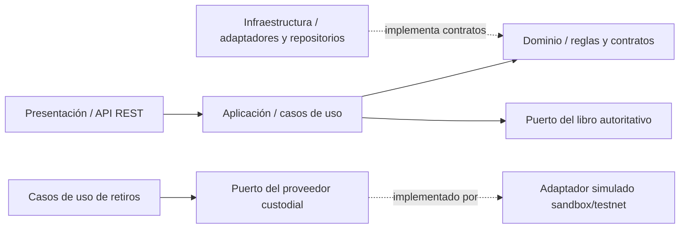

# Diseño interno de módulos

> **Estado:** propuesta académica; no describe código implementado ni habilita operaciones con fondos reales.
>
> **Modelo:** libro interno de saldos con fondos agrupados en un proveedor custodial.
>
> **Decisiones relacionadas:** [ADR007 y ADR008](../../01-analisis-del-sistema/07-decisiones-arquitectonicas.md).

## 1. Propósito y alcance

Este documento describe las responsabilidades y límites de los módulos del backend. La transferencia interna y el retiro externo son casos de uso distintos:

- Una **transferencia interna** mueve saldo entre dos usuarios de QuillaCoin, actualizando el libro autoritativo en una operación atómica. No llama al proveedor custodial ni a una blockchain.
- Un **retiro externo** solicita al proveedor custodial enviar activos a un destino externo. Tiene su propio registro, estados, clave de idempotencia y reconciliación; inicialmente se simula en sandbox/testnet.

La custodia, los movimientos y los saldos de la primera fase son simulados. No se manejan fondos ni claves privadas reales. El runtime, la base de datos concreta y el mecanismo de caché siguen pendientes de evaluación.

El diagrama C4 de Nivel 4 contiene el detalle de clases y secuencia para la transferencia interna: [`Nivel4-DiagramadeCodigo.md`](../../04-modelo-c4/Nivel4-DiagramadeCodigo.md). Las decisiones sobre libro/custodia y uso de IA están en [ADR007 y ADR008](../../01-analisis-del-sistema/07-decisiones-arquitectonicas.md).

## 2. Organización propuesta

La separación por módulos es lógica; la forma de despliegue objetivo sigue siendo un monolito modular.

```text
src/
├── modules/
│   ├── usuarios/
│   ├── libro-saldos/
│   ├── transferencias/
│   ├── retiros/
│   ├── compras/
│   ├── pagos/
│   └── notificaciones/
├── workers/
│   └── analisis-riesgo/
└── shared/
    ├── autenticacion/
    └── errores/
```

| Módulo | Responsabilidad y límites |
|---|---|
| `usuarios` | Identidad, autenticación, perfiles y permisos. |
| `libro-saldos` | Registros autoritativos de movimientos por usuario y activo; aplica las reglas de consistencia del almacenamiento seleccionado. |
| `transferencias` | Valida y solicita movimientos internos al libro. No conoce proveedores ni redes blockchain. |
| `retiros` | Registra solicitudes externas, su ciclo de estados e idempotencia; coordina el proveedor custodial mediante un puerto. |
| `compras` y `pagos` | Gestiona órdenes y pagos en PEN mediante una pasarela, seleccionada posteriormente. Un pago confirmado no debe acreditarse dos veces. |
| `notificaciones` | Comunica cambios de estado; no decide si una operación financiera fue confirmada. |
| `asistencia` | Atiende el chat mediante la API. Consulta información de cuenta solo por casos de uso autorizados; no tiene herramientas para ejecutar operaciones financieras. |
| `workers/analisis-riesgo` | Consume eventos durables del outbox/cola, aplica reglas y/o consulta un proveedor de IA, y persiste alertas no vinculantes para revisión. Se ejecuta fuera del proceso HTTP. |
| Adaptadores externos | Implementan contratos para pagos y custodia. En el alcance inicial son simuladores; el proveedor real no está seleccionado. |

## 3. Dependencias entre capas

Cada módulo aplica Clean Architecture: Presentación invoca Aplicación; Aplicación coordina reglas y contratos del Dominio; Infraestructura implementa dichos contratos. Las dependencias del dominio no apuntan a frameworks, almacenamiento ni SDK de proveedores.



La raíz de composición conecta las implementaciones concretas. El C4 usa Node.js + Express como referencia de backend; el hosting, la base de datos, la caché y los proveedores de IA siguen por seleccionar y deben validarse frente a las garantías operativas y de privacidad requeridas.

## 4. Asistencia conversacional

El frontend envía preguntas al backend autenticado. La API incorpora al contexto únicamente información general de ayuda y, cuando corresponda, datos operativos del propio usuario obtenidos mediante casos de uso existentes. No se expone al modelo una conexión directa a la base de datos ni se habilitan herramientas que ejecuten compras, transferencias, retiros, cambios de permisos o bloqueos.

El proveedor se integra mediante un puerto/adaptador. Se limita el tamaño y frecuencia de las consultas, se evita enviar credenciales, secretos y datos personales innecesarios, y se trata el texto del usuario como entrada no confiable. Si el servicio de IA falla o demora, el chat informa que no puede responder; las funciones financieras siguen disponibles.

## 5. Transferencia interna

El caso de uso toma la identidad de origen de la sesión autenticada, valida el destinatario, el activo y el monto, y entrega la operación al libro. El cliente no puede elegir arbitrariamente el usuario de origen.

La persistencia debe comprobar fondos e idempotencia y registrar el débito, el crédito y la transferencia como una única operación del almacenamiento autoritativo. Si falla cualquier paso, no queda un movimiento parcial. El método concreto de concurrencia depende de la base seleccionada y se validará con pruebas de concurrencia.

Los importes no se calculan con números binarios de punto flotante: se expresan en unidades mínimas enteras del activo, respetando su precisión. El caché puede servir lecturas derivadas, pero no autoriza débitos ni es fuente de verdad del saldo disponible.

Al confirmar la transferencia, el evento requerido para análisis se inserta en el outbox en la misma transacción del libro. Si no puede persistirse ese evento, la transacción financiera completa debe fallar; no se confirma un movimiento que el sistema no pueda posteriormente auditar/analizar según la política acordada. El worker procesa fuera de la ruta HTTP y usa identificadores idempotentes para tolerar reintentos.

## 6. Análisis asíncrono de riesgo

Inicialmente, el worker analiza transferencias internas confirmadas que tengan un evento en el outbox. Reclama los eventos pendientes, construye un conjunto minimizado de señales —preferentemente atributos derivados y seudónimos, no identificadores personales directos— y ejecuta reglas deterministas y/o solicita una evaluación al proveedor de IA. El resultado contiene una alerta o puntuación no vinculante, referencia al evento, señales resumidas, versión del analizador y estado de revisión. No demuestra por sí solo fraude.

Los errores temporales se reintentan; los eventos no procesables deben quedar visibles para recuperación manual. El procesamiento es idempotente para no duplicar alertas. El worker no accede a claves ni firma movimientos, y no puede suspender usuarios ni rechazar operaciones. Las medidas sobre cuentas se realizan únicamente a través de funciones administrativas autorizadas y auditadas.

## 7. Retiro externo

El retiro tiene un flujo independiente de la transferencia interna:

1. Validar usuario, activo, monto y destino externo.
2. Registrar la solicitud con una clave idempotente y un estado inicial antes de invocar al adaptador.
3. Enviar la solicitud al proveedor custodial simulado.
4. Persistir la respuesta o mantener un estado pendiente cuando el resultado sea incierto.
5. Reconciliar el estado con el proveedor antes de tratarlo como final y comunicar el resultado.

Los reintentos no deben crear retiros duplicados. QuillaCoin no envía transacciones directamente a la blockchain en esta fase; la liquidación externa corresponde al proveedor. La política exacta de reserva, liberación y contabilización del saldo de un retiro queda pendiente de especificación antes de implementar.

## 8. Decisiones aún abiertas

- Proveedor de pagos disponible para Perú y sus tarifas, límites y condiciones.
- Proveedor custodial y disponibilidad de sandbox/testnet.
- Activos admitidos, redes, precisión, mínimos, liquidez y comisiones.
- Runtime y base de datos en Cloudflare, según las garantías transaccionales requeridas.
- Tecnología y política de invalidación del caché.
- Estados de retiro, tratamiento de fondos reservados y procedimientos de reconciliación.
- Flujo automatizado de CI/CD y controles para promover despliegues.
- Proveedor/modelo de IA, datos permitidos, política de retención y metas de latencia.
- Política de reclamación/concurrencia del worker, reintentos, retención del outbox y tratamiento de eventos agotados; un broker externo podría añadirse si el volumen lo justifica.
- Señales, umbrales, explicación de alertas, permisos administrativos y procedimiento de revisión.

Estas decisiones no deben inferirse de ejemplos tecnológicos anteriores ni considerarse elegidas hasta documentarse.
