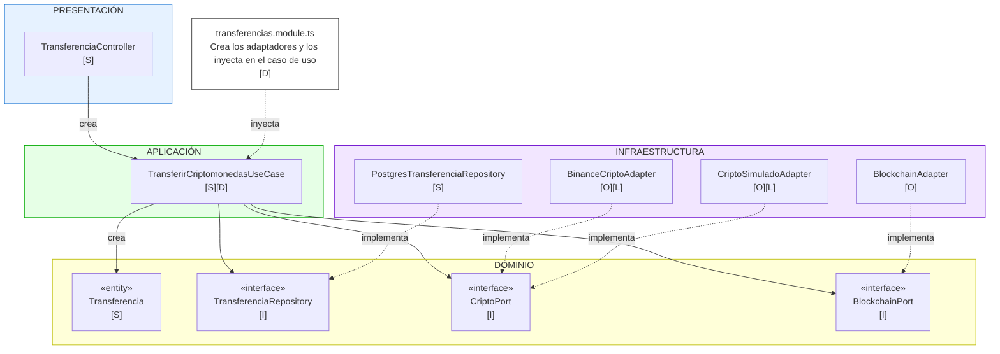

# Principios de diseño (SOLID)

## Objetivo

Documentar cómo se aplican los principios SOLID en el backend de Flexcoin, organizado con Clean Architecture, para que cada módulo se programe de forma uniforme y las reglas de negocio no dependan de la tecnología.

## Contexto

- **Estilo:** monolito modular (Node.js + Express).
- **Enfoque interno:** Clean Architecture (presentación, aplicación, dominio, infraestructura).
- **Módulo de referencia:** Transferencias, porque integra base de datos, proveedor de criptomonedas y red blockchain.

## SOLID en el módulo Transferencias

### Leyenda de principios SOLID

- **[S]** Responsabilidad única: una sola tarea por clase
- **[O]** Abierto/cerrado: nuevo proveedor = nueva clase
- **[L]** Liskov: Binance y el simulado son intercambiables
- **[I]** Segregación: interfaces pequeñas por necesidad
- **[D]** Inversión: el caso de uso depende de interfaces

## SOLID aplicado al módulo Transferencias

| Principio | Dónde se aplica | Cómo se cumple en Flexcoin | Archivos |
|---|---|---|---|
| **S** · Responsabilidad única | Todas las capas | Cada clase tiene una sola tarea: el controlador recibe la petición HTTP, el caso de uso coordina la transferencia, la entidad aplica las reglas del dominio y el repositorio guarda en PostgreSQL | `transferencia.controller.ts`, `transferir-criptomonedas.use-case.ts`, `transferencia.ts`, `postgres-transferencia-repository.ts` |
| **O** · Abierto/cerrado | Infraestructura | Para agregar un nuevo proveedor de criptomonedas se crea un nuevo adaptador; el caso de uso de transferencia no se modifica | `binance-cripto.adapter.ts`, `cripto-simulado.adapter.ts` |
| **L** · Sustitución de Liskov | Infraestructura | Binance y el simulado devuelven el mismo `ResultadoTransferencia`; el caso de uso funciona igual con cualquiera | `binance-cripto.adapter.ts`, `cripto-simulado.adapter.ts` |
| **I** · Segregación de interfaces | Dominio | Cada interfaz tiene solo lo que Transferencias necesita: `CriptoPort` solo transfiere, `BlockchainPort` solo registra on-chain, `TransferenciaRepository` solo guarda y busca transferencias | `cripto-port.ts`, `blockchain-port.ts`, `transferencia-repository.ts` |
| **D** · Inversión de dependencias | Aplicación | El caso de uso recibe interfaces por el constructor y no conoce Binance, PostgreSQL ni la red blockchain; las implementaciones se conectan en `transferencias.module.ts` | `transferir-criptomonedas.use-case.ts`, `transferencias.module.ts` |

## Qué pasaría sin SOLID en Flexcoin

| Situación real | Sin SOLID | Con SOLID |
|---|---|---|
| Se cambia Binance por otro proveedor de criptomonedas | Hay que modificar el caso de uso de transferencia | Solo se crea un nuevo adaptador |
| Se cambia la red blockchain | Se modifica el código del módulo Transferencias | Solo se reemplaza `BlockchainAdapter` |
| Se quiere probar la transferencia | Se necesita PostgreSQL, Binance y la blockchain real | Se prueba con implementaciones en memoria o simuladas |
| Cambia una regla del control de concurrencia | Hay que buscarla en controladores y servicios | Está solo en la entidad `Transferencia` y en el servicio de dominio |

## Relación con Clean Architecture y los patrones

| Principio | Lo cumple en el proyecto |
|---|---|
| Responsabilidad única | La separación en capas de Clean Architecture |
| Abierto/cerrado y Liskov | El patrón Adapter (proveedor de criptomonedas y blockchain) |
| Segregación de interfaces | Los puertos del dominio (`CriptoPort`, `BlockchainPort`, `TransferenciaRepository`) |
| Inversión de dependencias | El patrón Repository y la regla de dependencia: las capas externas dependen del dominio |