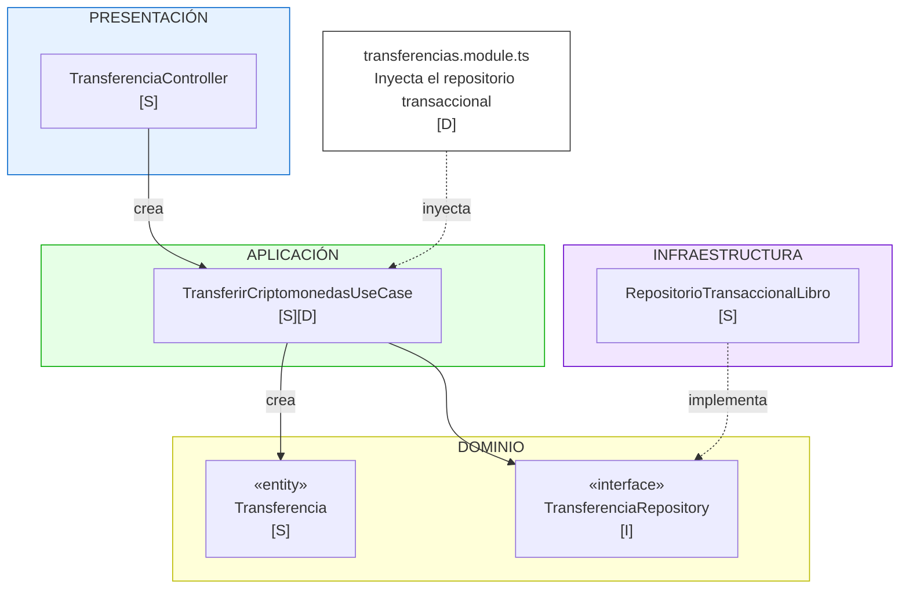

# Principios de diseño (SOLID)

## Objetivo

Documentar cómo se aplican los principios SOLID en el backend de QuillaCoin, organizado con Clean Architecture, para que cada módulo se programe de forma uniforme y las reglas de negocio no dependan de la tecnología.

## Contexto

- **Estilo:** monolito modular (Node.js + Express).
- **Enfoque interno:** Clean Architecture (presentación, aplicación, dominio, infraestructura).
- **Módulo de referencia:** Transferencias internas, porque debe mantener consistente el libro sin depender de servicios externos.

## SOLID en el módulo Transferencias

### Leyenda de principios SOLID

- **[S]** Responsabilidad única: una sola tarea por clase
- **[O]** Abierto/cerrado: nuevo proveedor = nueva clase
- **[L]** Liskov: implementaciones del repositorio respetan el mismo contrato
- **[I]** Segregación: interfaces pequeñas por necesidad
- **[D]** Inversión: el caso de uso depende de interfaces

## SOLID aplicado al módulo Transferencias

| Principio | Dónde se aplica | Cómo se cumple en QuillaCoin | Archivos |
|---|---|---|---|
| **S** · Responsabilidad única | Todas las capas | El controlador traduce HTTP, el caso de uso coordina, la entidad valida reglas y el repositorio registra atómicamente los movimientos | Archivos del módulo por definir |
| **O** · Abierto/cerrado | Infraestructura | La tecnología de persistencia se intercambia mediante una implementación del contrato transaccional, sin trasladar reglas al proveedor | Repositorio y adaptadores por definir |
| **L** · Sustitución de Liskov | Infraestructura | Las implementaciones reales y simuladas de persistencia o de servicios externos respetan sus contratos | Adaptadores por definir |
| **I** · Segregación de interfaces | Dominio/Aplicación | Transferencias internas depende del contrato del libro; pagos y retiros usan puertos separados para proveedores | Puertos por definir |
| **D** · Inversión de dependencias | Aplicación | El caso de uso depende del contrato transaccional y no de la base de datos ni de proveedores concretos | Módulos y adaptadores por definir |

## Qué pasaría sin SOLID en QuillaCoin

| Situación real | Sin SOLID | Con SOLID |
|---|---|---|
| Se cambia el proveedor custodial | Se modifica el caso de uso de transferencia | Solo se reemplaza el adaptador usado por compras o retiros |
| Se cambia la base de datos | Se dispersa SQL por las reglas del negocio | Se reemplaza la implementación del repositorio transaccional |
| Se quiere probar una transferencia interna | Se necesita un proveedor y una blockchain reales | Se prueba con una base transaccional de prueba y servicios externos simulados/no requeridos |
| Cambia una regla de consistencia | Hay que buscarla en controladores y servicios | Se mantiene en las reglas del dominio y el contrato transaccional |

## Relación con Clean Architecture y los patrones

| Principio | Lo cumple en el proyecto |
|---|---|
| Responsabilidad única | La separación en capas de Clean Architecture |
| Abierto/cerrado y Liskov | El patrón Adapter para proveedores externos y repositorios intercambiables |
| Segregación de interfaces | Contratos separados para movimientos internos y servicios externos |
| Inversión de dependencias | El patrón Repository y la regla de dependencia: las capas externas dependen del dominio |