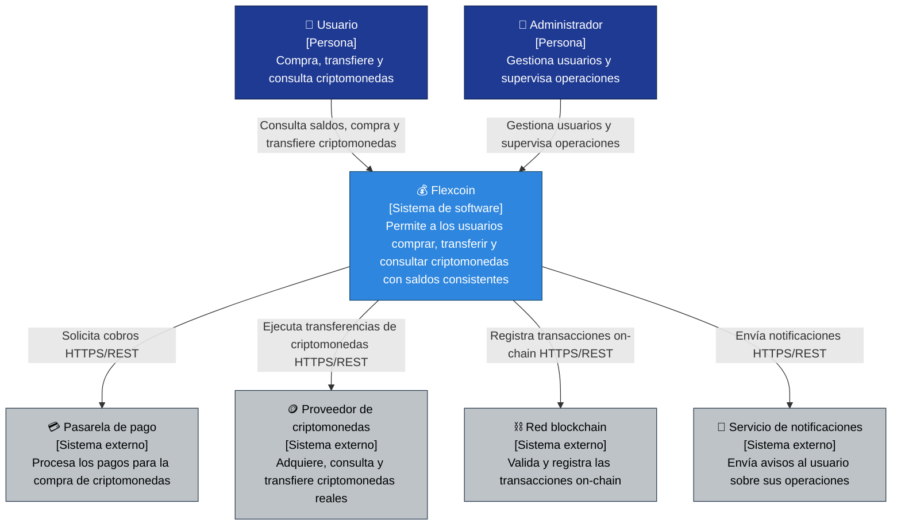

# Nivel 1 · Diagrama de contexto del sistema

> **Proyecto:** Flexcoin  
> **Modelo:** C4 · Nivel 1 de 4 · **Versión:** 1.0

---

## 1. Objetivo

Mostrar **Flexcoin como una sola caja**: quiénes lo usan y con qué sistemas externos se comunica. Es la vista de mayor nivel y la primera que se presenta a cualquier persona, técnica o no.

| Aspecto | Descripción |
|---|---|
| Pregunta que responde | ¿Qué es el sistema, quién lo usa y con quién se integra? |
| Audiencia | Todos: negocio, docentes, equipo de desarrollo, operaciones |
| Qué **no** muestra | Tecnologías, servidores, bases de datos ni módulos internos |
| Siguiente nivel | `Nivel2-DiagramadeContenedores.md` |

---

## 2. Diagrama

---

## 3. Personas (usuarios)

| Persona | Descripción | Qué hace en el sistema |
|---|---|---|
| **Usuario** | Persona que opera con criptomonedas | Consulta saldos, compra criptomonedas con tarjeta, transfiere a otros usuarios, retira a billeteras externas y consulta su historial |
| **Administrador** | Responsable de la operación de Flexcoin | Gestiona cuentas de usuario, supervisa las operaciones y configura el sistema |

---

## 4. Sistemas

| Sistema | Tipo | Responsabilidad | Quién lo construye |
|---|---|---|---|
| **Flexcoin** | Sistema en alcance | Permite a los usuarios comprar, transferir y consultar criptomonedas, garantizando la consistencia de los saldos | El equipo del proyecto |
| **Pasarela de pago** | Sistema externo | Procesa los pagos con tarjeta para la compra de criptomonedas | Proveedor de pagos |
| **Proveedor de criptomonedas** | Sistema externo | Adquiere, consulta y transfiere criptomonedas reales | Exchange o proveedor de servicios cripto |
| **Red blockchain** | Sistema externo | Valida y registra las transacciones on-chain | Infraestructura pública de la blockchain |
| **Servicio de notificaciones** | Sistema externo | Envía al usuario avisos sobre el estado de sus operaciones | Proveedor de correo, SMS o push |

---

## 5. Relaciones

| Origen | Destino | Descripción | Protocolo |
|---|---|---|---|
| Usuario | Flexcoin | Consulta saldos, compra y transfiere criptomonedas | - |
| Administrador | Flexcoin | Gestiona usuarios y supervisa operaciones | - |
| Flexcoin | Pasarela de pago | Solicita cobros | HTTPS/REST |
| Flexcoin | Proveedor de criptomonedas | Ejecuta transferencias y consultas de criptomonedas | HTTPS/REST |
| Flexcoin | Red blockchain | Registra y valida transacciones on-chain | HTTPS/REST |
| Flexcoin | Servicio de notificaciones | Envía avisos de estado de las operaciones | HTTPS/REST |

> En el nivel 1 no se indica el protocolo entre personas y sistema: eso se detalla en el nivel 2.

---

## 6. Decisiones y supuestos

| # | Decisión o supuesto | Motivo |
|---|---|---|
| 1 | Los sistemas externos se integran mediante sus API REST | Es el mecanismo que ofrecen los proveedores y no requiere acceso a sus bases de datos |
| 2 | Flexcoin **no almacena datos de tarjetas** | Los datos de pago los procesa la pasarela; se reduce el riesgo de seguridad |
| 3 | Flexcoin **no administra las claves privadas del usuario** | Las transferencias reales se delegan al proveedor de criptomonedas; el sistema solo registra y controla las operaciones internas |
| 4 | Los sistemas externos no se modifican | Son de terceros; Flexcoin se adapta a ellos (patrón Adapter) |

### Pendientes por definir

| Tema | Detalle |
|---|---|
| Canal de notificaciones | El módulo Notificaciones avisa al usuario el estado de sus operaciones; falta definir si será correo, SMS o push. Cuando se defina, se agregará como sistema externo |
| Alcance del retiro | Confirmar si el retiro a billetera externa se delega al proveedor de criptomonedas o se ejecuta directamente contra la red blockchain |
| Moneda de cobro | Definir si la pasarela cobra en soles y Flexcoin convierte a criptomonedas, o si el cobro es directo en cripto |