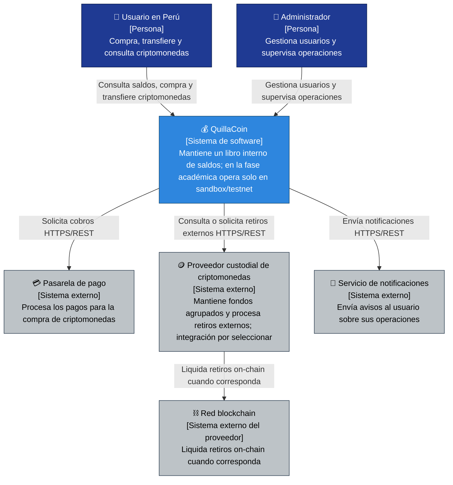

# Nivel 1 · Diagrama de contexto del sistema

> **Proyecto:** QuillaCoin 
> **Modelo:** C4 · Nivel 1 de 4 · **Versión:** 1.0

---

## 1. Objetivo

Mostrar **QuillaCoin como una sola caja**: quiénes lo usan y con qué sistemas externos se comunica. Es la vista de mayor nivel y la primera que se presenta a cualquier persona, técnica o no.

| Aspecto | Descripción |
|---|---|
| Pregunta que responde | ¿Qué es el sistema, quién lo usa y con quién se integra? |
| Audiencia | Todos: negocio, docentes, equipo de desarrollo, operaciones |
| Qué **no** muestra | Tecnologías, servidores, bases de datos ni módulos internos |
| Siguiente nivel | `Nivel2-DiagramadeContenedores.md` |

---

## 2. Diagrama

---

## 3. Personas (usuarios)

| Persona | Descripción | Qué hace en el sistema |
|---|---|---|
| **Usuario** | Persona ubicada en Perú que opera con criptomonedas | Consulta saldos, compra mediante medios de pago locales, transfiere internamente a otros usuarios, solicita retiros externos y consulta su historial |
| **Administrador** | Responsable de la operación de QuillaCoin | Gestiona cuentas de usuario, supervisa las operaciones y configura el sistema |

---

## 4. Sistemas

| Sistema | Tipo | Responsabilidad | Quién lo construye |
|---|---|---|---|
| **QuillaCoin** | Sistema en alcance | Mantiene el libro interno de saldos y distingue movimientos internos de retiros externos | El equipo del proyecto |
| **Pasarela de pago** | Sistema externo | Procesa pagos en PEN mediante medios disponibles en Perú; proveedor por seleccionar | Proveedor de pagos |
| **Proveedor custodial de criptomonedas** | Sistema externo | Mantiene fondos agrupados y expone operaciones y estados mediante API; proveedor y condiciones por validar | Exchange o proveedor de servicios cripto |
| **Red blockchain** | Sistema externo del proveedor | Liquida retiros on-chain cuando corresponda; QuillaCoin no se integra directamente en la fase inicial | Infraestructura de la red elegida por el proveedor |
| **Servicio de notificaciones** | Sistema externo | Envía al usuario avisos sobre el estado de sus operaciones | Proveedor de correo, SMS o push |

---

## 5. Relaciones

| Origen | Destino | Descripción | Protocolo |
|---|---|---|---|
| Usuario | QuillaCoin | Consulta saldos, compra y transfiere criptomonedas | - |
| Administrador | QuillaCoin | Gestiona usuarios y supervisa operaciones | - |
| QuillaCoin | Pasarela de pago | Solicita cobros | HTTPS/REST |
| QuillaCoin | Proveedor custodial | Consulta información o solicita retiros externos, separados de las transferencias internas | HTTPS/REST |
| Proveedor custodial | Red blockchain | Liquida en cadena los retiros externos cuando corresponda | Protocolo del proveedor |
| QuillaCoin | Servicio de notificaciones | Envía avisos de estado de las operaciones | HTTPS/REST |

> En el nivel 1 no se indica el protocolo entre personas y sistema: eso se detalla en el nivel 2.

---

## 6. Decisiones y supuestos

| # | Decisión o supuesto | Motivo |
|---|---|---|
| 1 | Los sistemas externos se integran mediante sus API REST | Es el mecanismo que ofrecen los proveedores y no requiere acceso a sus bases de datos |
| 2 | QuillaCoin **no almacena datos de tarjetas** | Los datos de pago los procesa la pasarela; se reduce el riesgo de seguridad |
| 3 | QuillaCoin mantiene un libro interno; el proveedor custodial agrupa los fondos externos | QuillaCoin no guarda claves privadas; en la fase académica se simulan el libro, el proveedor y los movimientos, sin fondos reales |
| 4 | Los sistemas externos no se modifican | Son de terceros; QuillaCoin se adapta a ellos (patrón Adapter) |

### Pendientes por definir

| Tema | Detalle |
|---|---|
| Canal de notificaciones | El módulo Notificaciones avisa al usuario el estado de sus operaciones; falta definir si será correo, SMS o push. Cuando se defina, se agregará como sistema externo |
| Operación con fondos reales | Validar proveedor, condiciones de custodia agrupada, capacidades de retiro, obligaciones aplicables en Perú y criterios antes de salir de sandbox/testnet |
| Proveedores y activos | Seleccionar una pasarela disponible en Perú para pagos en PEN y los activos digitales compatibles; verificar tarifas, mínimos y condiciones |
| Selección de activos | Elegir activos disponibles para el mercado peruano y el proveedor seleccionado, considerando liquidez, mínimos y comisiones de operación y retiro; el precio unitario no es el único criterio |
| Base de datos y caché | Comparar alternativas compatibles con Cloudflare y validar transacciones, consistencia y soporte; el caché no será fuente de verdad |
| Despliegue CI/CD | Definir entornos, verificaciones y política de promoción; la automatización forma parte del alcance previsto |