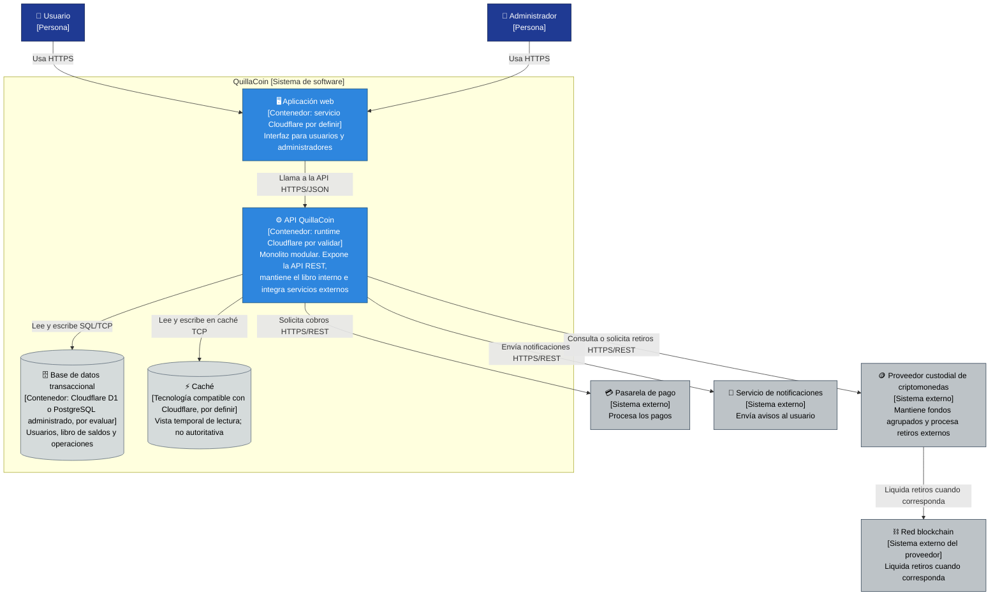

# Nivel 2 · Diagrama de contenedores

> **Proyecto:** QuillaCoin 
> **Modelo:** C4 · Nivel 2 de 4 · **Versión:** 1.0

---

## 1. Objetivo

Abrir la caja «QuillaCoin» del nivel 1 y mostrar los **contenedores** que la forman: las aplicaciones y almacenes de datos que se ejecutan por separado, la tecnología de cada uno y cómo se comunican.

| Aspecto | Descripción |
|---|---|
| Pregunta que responde | ¿De qué piezas ejecutables se compone el sistema y con qué tecnología? |
| Audiencia | Arquitectos, desarrolladores, operaciones |
| Qué es un contenedor | Algo que se ejecuta o almacena datos de forma independiente: una aplicación web, una API, una base de datos (no es lo mismo que un contenedor Docker) |
| Nivel anterior | `Nivel1-DiagramadeContextodelSistema.md` |
| Siguiente nivel | `Nivel3-Diagrama-de-Componentes.md` |

---

## 2. Diagrama

---

## 3. Contenedores

| Contenedor | Tecnología | Responsabilidad | Datos que maneja |
|---|---|---|---|
| **Aplicación web** | Servicio de publicación de Cloudflare por definir | Interfaz de operaciones para usuarios y administradores | Ninguno persistente; solo el estado de la pantalla |
| **API QuillaCoin** | Runtime de Cloudflare por validar | Expone la API REST, mantiene el libro interno, aplica las reglas del negocio e integra servicios externos. Es un **monolito modular** | Usa almacenamiento transaccional y caché |
| **Base de datos** | Cloudflare D1 o PostgreSQL administrado; decisión pendiente | Almacena permanentemente el libro de saldos y los registros operativos. La opción debe demostrar garantías transaccionales adecuadas | Usuarios, movimientos contables, operaciones y estados externos |
| **Caché** | Tecnología por definir dentro del entorno Cloudflare | Acelera consultas de lectura sin autorizar ni contabilizar movimientos | Vista temporal derivada; nunca es fuente de verdad del saldo |

---

## 4. Relaciones

| Origen | Destino | Descripción | Protocolo |
|---|---|---|---|
| Usuario, Administrador | Aplicación web | Usan la aplicación desde el navegador | HTTPS |
| Aplicación web | API QuillaCoin | Llama a la API | HTTPS/JSON |
| API QuillaCoin | Base de datos | Lee y escribe el libro y las operaciones usando transacciones | Protocolo del servicio seleccionado |
| API QuillaCoin | Caché | Lee y actualiza datos derivados para consultas | Protocolo del servicio seleccionado |
| API QuillaCoin | Pasarela de pago | Solicita cobros | HTTPS/REST |
| API QuillaCoin | Proveedor custodial | Consulta información y solicita retiros externos; no interviene en las transferencias internas | HTTPS/REST |
| Proveedor custodial | Red blockchain | Liquida retiros externos cuando corresponda | Protocolo del proveedor |
| API QuillaCoin | Servicio de notificaciones | Envía avisos de estado | HTTPS/REST |

---

## 5. Decisiones arquitectónicas reflejadas

| Decisión | Alternativa descartada | Motivo |
|---|---|---|
| Un único contenedor de backend (monolito modular) | Microservicios | Equipo pequeño y plazo acotado; los módulos permiten separar servicios en el futuro si es necesario |
| Frontend separado del backend (SPA + API REST) | Páginas generadas en el servidor | El frontend y el backend evolucionan y se despliegan de forma independiente |
| Despliegue en Cloudflare | Plataforma por seleccionar | Plataforma objetivo; el runtime y los servicios concretos se validarán por compatibilidad |
| D1 o PostgreSQL administrado como base de datos | Decisión pendiente | Comparar soporte transaccional, consistencia, operación y compatibilidad con el runtime antes de elegir |
| Caché derivada | Leer siempre desde el almacenamiento en cada consulta | Puede reducir carga y latencia; nunca decide fondos disponibles ni participa como fuente de verdad |
| Solo la API se comunica con los sistemas externos | Llamar a la pasarela o al proveedor desde el navegador | Las credenciales de los proveedores quedan en el servidor y no se exponen al cliente |

---

## 6. Seguridad entre contenedores

| Comunicación | Medida |
|---|---|
| Navegador → Aplicación web y API | Tráfico cifrado con HTTPS |
| Aplicación web → API | Autenticación con token JWT en cada petición |
| API → Base de datos y caché | Usar los mecanismos de acceso y gestión de secretos del servicio seleccionado |
| API → Sistemas externos | Credenciales del proveedor y la pasarela solo en el entorno servidor; comunicaciones HTTPS con TLS |
| Administración del despliegue | SSH solo si la plataforma lo ofrece y se requiere; no sustituye HTTPS/TLS |