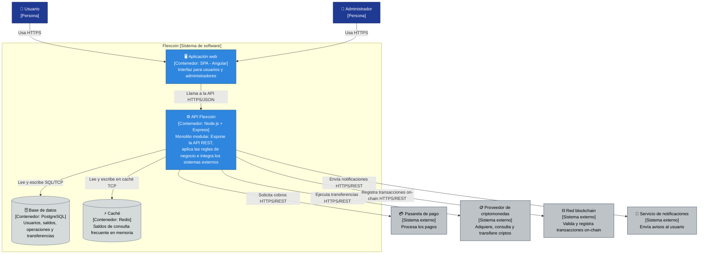

# Nivel 2 · Diagrama de contenedores

> **Proyecto:** Flexcoin  
> **Modelo:** C4 · Nivel 2 de 4 · **Versión:** 1.0

---

## 1. Objetivo

Abrir la caja «Flexcoin» del nivel 1 y mostrar los **contenedores** que la forman: las aplicaciones y almacenes de datos que se ejecutan por separado, la tecnología de cada uno y cómo se comunican.

| Aspecto | Descripción |
|---|---|
| Pregunta que responde | ¿De qué piezas ejecutables se compone el sistema y con qué tecnología? |
| Audiencia | Arquitectos, desarrolladores, operaciones |
| Qué es un contenedor | Algo que se ejecuta o almacena datos de forma independiente: una aplicación web, una API, una base de datos (no es lo mismo que un contenedor Docker) |
| Nivel anterior | `Nivel1-DiagramadeContextodelSistema.md` |
| Siguiente nivel | `Nivel3-Diagrama-de-Componentes.md` |

---

## 2. Diagrama

---

## 3. Contenedores

| Contenedor | Tecnología | Responsabilidad | Datos que maneja |
|---|---|---|---|
| **Aplicación web** | SPA · Angular | Interfaz de operaciones para usuarios y panel de administración. Se ejecuta en el navegador | Ninguno persistente; solo el estado de la pantalla |
| **API Flexcoin** | Node.js + Express | Expone la API REST, aplica las reglas de negocio, controla la concurrencia e integra los sistemas externos. Es un **monolito modular**: un solo proceso con módulos internos | Ninguno propio; usa la base de datos y la caché |
| **Base de datos** | PostgreSQL | Almacena de forma permanente la información del negocio | Usuarios, saldos, operaciones y transferencias |
| **Caché** | Redis | Guarda en memoria los saldos más consultados para responder más rápido | Copia temporal de los saldos |

---

## 4. Relaciones

| Origen | Destino | Descripción | Protocolo |
|---|---|---|---|
| Usuario, Administrador | Aplicación web | Usan la aplicación desde el navegador | HTTPS |
| Aplicación web | API Flexcoin | Llama a la API | HTTPS/JSON |
| API Flexcoin | Base de datos | Lee y escribe información | SQL sobre TCP |
| API Flexcoin | Caché | Lee y escribe los saldos en memoria | TCP |
| API Flexcoin | Pasarela de pago | Solicita cobros | HTTPS/REST |
| API Flexcoin | Proveedor de criptomonedas | Ejecuta transferencias y consultas | HTTPS/REST |
| API Flexcoin | Red blockchain | Registra transacciones on-chain | HTTPS/REST |
| API Flexcoin | Servicio de notificaciones | Envía avisos de estado | HTTPS/REST |

---

## 5. Decisiones arquitectónicas reflejadas

| Decisión | Alternativa descartada | Motivo |
|---|---|---|
| Un único contenedor de backend (monolito modular) | Microservicios | Equipo pequeño y plazo acotado; los módulos permiten separar servicios en el futuro si es necesario |
| Frontend separado del backend (SPA + API REST) | Páginas generadas en el servidor | El frontend y el backend evolucionan y se despliegan de forma independiente |
| PostgreSQL como base de datos | Base de datos NoSQL | Los saldos y las transferencias necesitan transacciones y consistencia |
| Redis como caché de saldos | Consultar siempre la base de datos | Los saldos son lo más consultado; la caché reduce el tiempo de respuesta y la carga sobre PostgreSQL |
| Solo la API se comunica con los sistemas externos | Llamar a la pasarela o al proveedor desde el navegador | Las credenciales de los proveedores quedan en el servidor y no se exponen al cliente |

---

## 6. Seguridad entre contenedores

| Comunicación | Medida |
|---|---|
| Navegador → Aplicación web y API | Tráfico cifrado con HTTPS |
| Aplicación web → API | Autenticación con token JWT en cada petición |
| API → Base de datos y caché | Acceso solo desde la red interna; credenciales en variables de entorno |
| API → Sistemas externos | Credenciales de cada proveedor guardadas solo en el servidor |