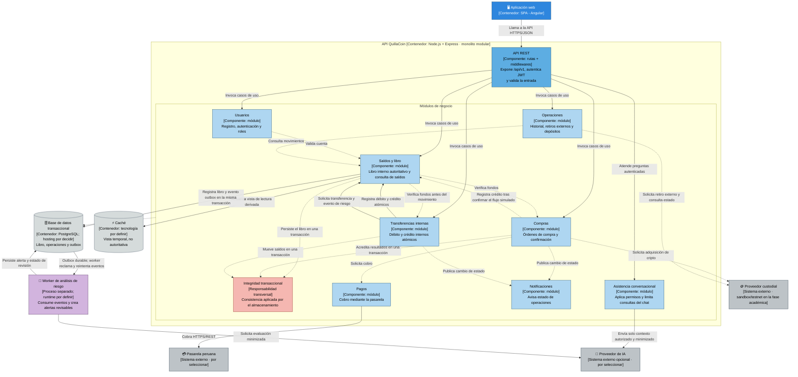

# Nivel 3 · Diagrama de componentes

> **Proyecto:** QuillaCoin · **Contenedor detallado:** API QuillaCoin 
> **Modelo:** C4 · Nivel 3 de 4 · **Versión:** 1.0

---

## 1. Objetivo

Abrir el contenedor **API QuillaCoin** del nivel 2 y mostrar sus **componentes**: los módulos del monolito modular, la responsabilidad de cada uno y cómo se relacionan entre sí y con la base de datos, la caché y los sistemas externos.

| Aspecto | Descripción |
|---|---|
| Pregunta que responde | ¿Cómo se divide el backend por dentro y qué hace cada parte? |
| Audiencia | Arquitectos y desarrolladores |
| Qué es un componente | Un grupo de funcionalidades con una responsabilidad clara, accesible mediante una interfaz. En este proyecto, cada **módulo** del monolito es un componente |
| Nivel anterior | `Nivel2-DiagramadeContenedores.md` |
| Siguiente nivel | `Nivel4-DiagramadeCodigo.md` |

---

## 2. Diagrama

---

## 3. Componentes

| Componente | Responsabilidad | Funcionalidades principales | Carpeta en el código |
|---|---|---|---|
| **API REST** | Punto de entrada HTTP del contenedor | Rutas `/api/v1`, autenticación JWT, validación de la entrada, manejo de errores | `src/api/` |
| **Usuarios** | Identidad y acceso | Registro, inicio de sesión, roles (usuario, administrador) | `src/modules/usuarios/` |
| **Saldos y libro** | Fuente de verdad de los saldos internos | Registra movimientos y expone saldos derivados del libro | `src/modules/saldos/` |
| **Compras** | Adquisición de criptomonedas | Órdenes de compra y confirmación con la pasarela | `src/modules/compras/` |
| **Transferencias** | Movimientos internos | Débito y crédito atómicos entre usuarios; no invoca proveedor ni blockchain | `src/modules/transferencias/` |
| **Operaciones** | Historial y movimientos externos | Historial, retiros con estados y depósitos simulados en la fase académica | `src/modules/operaciones/` |
| **Integridad transaccional** | Integridad del libro | Garantías de concurrencia y prevención de doble gasto mediante el almacenamiento autoritativo; no requiere un bloqueo en memoria | Responsabilidad transversal de Saldos y los repositorios |
| **Pagos** | Cobros | Cobro mediante la pasarela de pago | `src/modules/pagos/` |
| **Notificaciones** | Comunicación con el usuario | Avisar el estado de las operaciones | `src/modules/notificaciones/` |
| **Asistencia conversacional** | Atención al usuario | Responder preguntas del producto y consultar datos propios autorizados; no invoca operaciones financieras | `src/modules/asistencia/` |
| **Outbox y consumo de eventos** | Entrega confiable | Persistir junto con la transferencia el evento que requiere análisis; el worker lo reclama y reintenta | Tabla PostgreSQL durable |
| **Worker de análisis de riesgo** | Análisis posterior | Procesar eventos del outbox, consultar reglas/modelo y generar alertas no vinculantes; no modifica saldos ni bloquea cuentas | `src/workers/analisis-riesgo/` |

---

## 4. Relaciones entre componentes

| Origen | Destino | Descripción | Tipo de comunicación |
|---|---|---|---|
| Aplicación web | API REST | Llama a la API | HTTPS/JSON |
| API REST | Módulos de negocio | Invoca los casos de uso | Llamada en memoria |
| Usuarios | Saldos | Valida la cuenta antes de operar | Llamada en memoria (API pública del módulo) |
| Compras | Saldos | Acredita el resultado confirmado mediante el libro | Llamada en memoria |
| Compras | Pagos | Solicita el cobro | Llamada en memoria |
| Transferencias internas | Saldos y libro | Registra atómicamente débito y crédito; rechaza fondos insuficientes | Caso de uso/repository transaccional |
| Operaciones | Saldos | Consulta movimientos para el historial | Llamada en memoria |
| Operaciones | Proveedor custodial | Solicita retiros externos y reconcilia estados | HTTPS/REST |
| Saldos, Compras, Transferencias | Integridad transaccional | Aplica las garantías de concurrencia del almacenamiento del libro | Transacción del repositorio |
| Compras, Transferencias, Operaciones | Notificaciones | Publica cambios de estado | Evento en memoria o mecanismo por definir |
| Usuario | Asistencia conversacional | Formula preguntas en contexto autenticado; el módulo aplica autorización y minimización | HTTPS/JSON vía API |
| Asistencia conversacional | Proveedor de IA | Solicita una respuesta acotada; el backend conserva control sobre las consultas de cuenta | HTTPS/API vía Adapter |
| Transferencias internas | Outbox | Registra un evento durable dentro de la transacción financiera | Misma transacción del almacenamiento |
| Outbox | Worker de análisis de riesgo | Conserva eventos y permite que el worker los reclame, procese y reintente idempotentemente | Protocolo del almacenamiento |
| Worker de análisis de riesgo | Proveedor de IA | Solicita evaluación sobre señales minimizadas, no una decisión automática | HTTPS/API vía Adapter |
| Worker de análisis de riesgo | Repositorio de alertas | Persiste señal, evento de origen, versión del analizador y estado de revisión | Persistencia |

---

## 5. Relaciones con contenedores y sistemas externos

| Componente | Destino | Descripción | Protocolo | Patrón aplicado |
|---|---|---|---|---|
| Módulo Saldos | PostgreSQL (hosting por decidir) | Es propietario del libro de saldos y registra movimientos atómicos y eventos outbox | Protocolo PostgreSQL | Repository |
| Módulos de negocio | PostgreSQL | Persisten sus datos mediante repositorios; no modifican directamente el libro de otro módulo | Protocolo PostgreSQL | Repository |
| Saldos | Caché (tecnología por definir) | Mantiene vistas derivadas para lectura; nunca autoriza fondos ni registra movimientos | Protocolo del servicio seleccionado | Decorator |
| Pagos | Pasarela de pago | Cobra | HTTPS/REST | Adapter |
| Compras | Proveedor custodial | Solicita adquisición/consulta de activos; simulado en la fase académica | HTTPS/REST | Adapter |
| Operaciones | Proveedor custodial | Solicita retiros externos y consulta/reconcilia su estado | HTTPS/REST | Adapter |
| Proveedor custodial | Red blockchain | Liquida retiros externos cuando corresponda | Según proveedor | Integración del proveedor |
| Notificaciones | Servicio de notificaciones | Envía el aviso al usuario | HTTPS/REST | Adapter |
| Módulo Asistencia | Proveedor de IA | Genera respuestas del chat con contexto permitido; salida no ejecutable | HTTPS/API | Adapter |
| Worker de análisis | Proveedor de IA (opcional) | Evalúa señales minimizadas; la salida solo crea una alerta no vinculante | HTTPS/API | Adapter / Strategy |
| Outbox | Worker de análisis | Conserva eventos pendientes; permite reintento y recuperación idempotente | Protocolo del almacenamiento | Transactional Outbox |

---

## 6. Reglas del monolito modular

| # | Regla | Motivo |
|---|---|---|
| 1 | Los módulos síncronos se despliegan juntos en la API; el worker comparte el código y contratos, pero se ejecuta como proceso separado | Aísla el trabajo asíncrono y permite procesarlo independientemente sin convertir los módulos en microservicios |
| 2 | Un módulo usa a otro solo a través de su API pública (`index.ts`) | Evita que un cambio interno en un módulo rompa a los demás |
| 3 | Un módulo no lee ni escribe las tablas de otro módulo | Mantiene la independencia de los datos de cada módulo |
| 4 | Los proveedores externos se acceden mediante puertos/adaptadores controlados; el proveedor de IA puede ser compartido por chat y worker | Centraliza credenciales y permite sustituir proveedores sin acoplar los casos de uso |
| 5 | La consistencia del libro se garantiza mediante el almacenamiento transaccional autoritativo | Ningún evento de IA sustituye la operación atómica ni participa en su autorización |
| 6 | Cada módulo se organiza por dentro con Clean Architecture | Las reglas de negocio no dependen de la tecnología (ver nivel 4) |
| 7 | El análisis asíncrono solo consume eventos y escribe alertas; no modifica el libro ni suspende cuentas | Mantiene mínimo privilegio y evita que una salida probabilística ejecute acciones irreversibles |