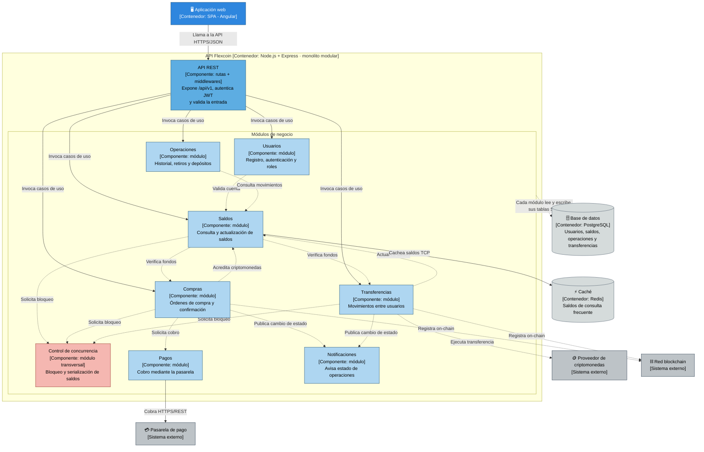

# Nivel 3 · Diagrama de componentes

> **Proyecto:** Flexcoin · **Contenedor detallado:** API Flexcoin  
> **Modelo:** C4 · Nivel 3 de 4 · **Versión:** 1.0

---

## 1. Objetivo

Abrir el contenedor **API Flexcoin** del nivel 2 y mostrar sus **componentes**: los módulos del monolito modular, la responsabilidad de cada uno y cómo se relacionan entre sí y con la base de datos, la caché y los sistemas externos.

| Aspecto | Descripción |
|---|---|
| Pregunta que responde | ¿Cómo se divide el backend por dentro y qué hace cada parte? |
| Audiencia | Arquitectos y desarrolladores |
| Qué es un componente | Un grupo de funcionalidades con una responsabilidad clara, accesible mediante una interfaz. En este proyecto, cada **módulo** del monolito es un componente |
| Nivel anterior | `Nivel2-DiagramadeContenedores.md` |
| Siguiente nivel | `Nivel4-DiagramadeCodigo.md` |

---

## 2. Diagrama

---

## 3. Componentes

| Componente | Responsabilidad | Funcionalidades principales | Carpeta en el código |
|---|---|---|---|
| **API REST** | Punto de entrada HTTP del contenedor | Rutas `/api/v1`, autenticación JWT, validación de la entrada, manejo de errores | `src/api/` |
| **Usuarios** | Identidad y acceso | Registro, inicio de sesión, roles (usuario, administrador) | `src/modules/usuarios/` |
| **Saldos** | Estado de las cuentas | Consulta y actualización de los saldos de criptomonedas | `src/modules/saldos/` |
| **Compras** | Adquisición de criptomonedas | Órdenes de compra y confirmación con la pasarela | `src/modules/compras/` |
| **Transferencias** | Movimientos entre usuarios | Transferencias de criptomonedas entre cuentas | `src/modules/transferencias/` |
| **Operaciones** | Historial y movimientos externos | Historial, retiros y depósitos | `src/modules/operaciones/` |
| **Control de concurrencia** | Coordinación de saldos | Bloqueo y serialización de operaciones que modifican saldos | `src/modules/control-concurrencia/` |
| **Pagos** | Cobros | Cobro mediante la pasarela de pago | `src/modules/pagos/` |
| **Notificaciones** | Comunicación con el usuario | Avisar el estado de las operaciones | `src/modules/notificaciones/` |

---

## 4. Relaciones entre componentes

| Origen | Destino | Descripción | Tipo de comunicación |
|---|---|---|---|
| Aplicación web | API REST | Llama a la API | HTTPS/JSON |
| API REST | Módulos de negocio | Invoca los casos de uso | Llamada en memoria |
| Usuarios | Saldos | Valida la cuenta antes de operar | Llamada en memoria (API pública del módulo) |
| Saldos | Compras | Verifica fondos disponibles | Llamada en memoria |
| Saldos | Transferencias | Verifica fondos disponibles | Llamada en memoria |
| Compras | Saldos | Acredita criptomonedas tras confirmar el cobro | Llamada en memoria |
| Compras | Pagos | Solicita el cobro | Llamada en memoria |
| Transferencias | Saldos | Actualiza saldos origen y destino | Llamada en memoria |
| Operaciones | Saldos | Consulta movimientos para el historial | Llamada en memoria |
| Saldos, Compras, Transferencias | Control de concurrencia | Solicita bloqueo antes de modificar un saldo | Llamada en memoria |
| Compras, Transferencias | Notificaciones | Publica el cambio de estado | Evento en memoria |

---

## 5. Relaciones con contenedores y sistemas externos

| Componente | Destino | Descripción | Protocolo | Patrón aplicado |
|---|---|---|---|---|
| Todos los módulos | Base de datos (PostgreSQL) | Cada módulo lee y escribe **solo sus propias tablas** | SQL | Repository |
| Saldos | Caché (Redis) | Guarda y lee saldos en memoria | TCP | Decorator |
| Pagos | Pasarela de pago | Cobra | HTTPS/REST | Adapter |
| Compras, Transferencias | Proveedor de criptomonedas | Ejecuta la operación sobre criptomonedas reales | HTTPS/REST | Adapter |
| Compras, Transferencias | Red blockchain | Registra la transacción on-chain | HTTPS/REST | Adapter |
| Notificaciones | Servicio de notificaciones | Envía el aviso al usuario | HTTPS/REST | Adapter |

---

## 6. Reglas del monolito modular

| # | Regla | Motivo |
|---|---|---|
| 1 | Todos los componentes se despliegan juntos en el contenedor API Flexcoin | Es un monolito: un solo proceso y un solo despliegue |
| 2 | Un módulo usa a otro solo a través de su API pública (`index.ts`) | Evita que un cambio interno en un módulo rompa a los demás |
| 3 | Un módulo no lee ni escribe las tablas de otro módulo | Mantiene la independencia de los datos de cada módulo |
| 4 | Cada sistema externo se integra en un único módulo | La integración queda en un solo lugar y es fácil de reemplazar |
| 5 | El control de concurrencia es transversal | Ningún módulo modifica saldos sin solicitar bloqueo |
| 6 | Cada módulo se organiza por dentro con Clean Architecture | Las reglas de negocio no dependen de la tecnología (ver nivel 4) |