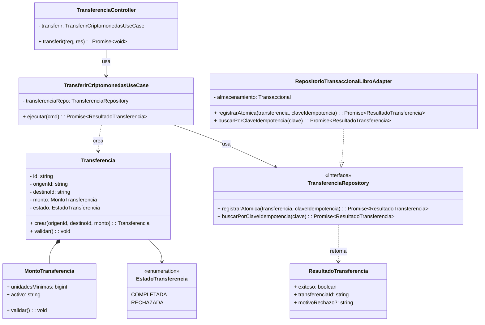
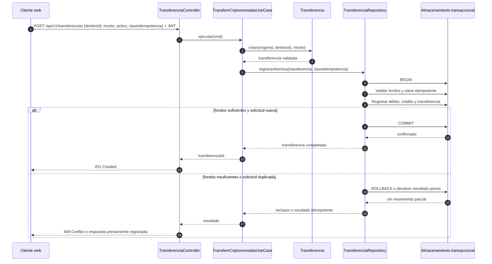

# Nivel 4 · Diagrama de código

> **Proyecto:** QuillaCoin · **Módulo detallado:** Transferencias internas 
> **Modelo:** C4 · Nivel 4 de 4 · **Notación:** UML · **Versión:** 1.0

---

## 1. Objetivo

Mostrar una propuesta de organización para el flujo **Transferir internamente activos entre usuarios**. Esta operación solo cambia el libro de saldos de QuillaCoin. Los retiros externos son otro flujo: se registran con estados y se solicitan al proveedor custodial.

El chat y el worker de análisis de riesgo son capacidades separadas, descritas en ADR008 y en el C4 de niveles 2 y 3; no forman parte de esta secuencia de transferencia.

| Aspecto | Descripción |
|---|---|
| Pregunta que responde | ¿Qué clases existen dentro de un módulo y cómo se relacionan? |
| Audiencia | Desarrolladores |
| Notación | UML (diagrama de clases y diagrama de secuencia). El modelo C4 recomienda UML para este nivel |
| Alcance del diagrama | Transferencia interna en una transacción del almacenamiento autoritativo; no incluye llamadas al proveedor ni a la blockchain |
| Nivel anterior | `Nivel3-Diagrama-de-Componentes.md` |

---

## 2. Diagrama de clases

### 2.1 Capas de Clean Architecture

| Capa | Contiene | Regla |
|---|---|---|
| **Presentación** | Controladores | Traduce HTTP a llamadas del caso de uso y viceversa |
| **Aplicación** | Casos de uso | Coordina los pasos del proceso; no conoce la tecnología |
| **Dominio** | Entidades, objetos de valor, interfaces | Contiene las reglas del negocio; no importa nada de las otras capas |
| **Infraestructura** | Repositorios y adaptadores | Implementa las interfaces del dominio con una tecnología concreta |

> **Regla de dependencia:** las flechas del código apuntan hacia el dominio. Las clases de infraestructura implementan interfaces del dominio (triángulo hueco); el dominio nunca conoce a la infraestructura.

### 2.2 Clases del módulo Transferencias

| Clase | Tipo | Capa | Responsabilidad |
|---|---|---|---|
| `TransferenciaController` | Controlador | Presentación | Recibe `POST /api/v1/transferencias` y responde al cliente |
| `TransferirCriptomonedasUseCase` | Caso de uso | Aplicación | Valida la solicitud y coordina el registro atómico de los dos movimientos internos |
| `Transferencia` | Entidad | Dominio | Valida origen, destino y monto de la transferencia interna |
| `MontoTransferencia` | Objeto de valor | Dominio | Monto y criptomoneda con validación propia |
| `EstadoTransferencia` | Enumeración | Dominio | COMPLETADA o RECHAZADA; la operación interna se confirma dentro de una transacción |
| `TransferenciaRepository` | Interfaz | Aplicación/Dominio | Contrato para aplicar el débito, el crédito y el registro en una transacción, con idempotencia |
| `RepositorioTransaccionalLibroAdapter` | Repositorio | Infraestructura | Implementa el contrato usando el almacenamiento transaccional seleccionado, aún por definir |

La garantía de concurrencia proviene de la operación atómica del almacenamiento autoritativo, no de un bloqueo en memoria. El mecanismo concreto dependerá de la base de datos seleccionada y deberá probarse bajo carga concurrente.

### 2.4 Notación UML utilizada

| Símbolo | Significado | Ejemplo |
|---|---|---|
| Línea continua con flecha abierta | Asociación: la clase tiene una referencia a la otra | `TransferirCriptomonedasUseCase` → `TransferenciaRepository` |
| Línea discontinua con flecha abierta | Dependencia: la usa o la crea | `TransferirCriptomonedasUseCase` «crea» `Transferencia` |
| Línea discontinua con triángulo hueco | Realización: implementa una interfaz | `RepositorioTransaccionalLibroAdapter` ▷ `TransferenciaRepository` |
| Rombo relleno | Composición: la parte no existe sin el todo | `Transferencia` ◆ `MontoTransferencia` |
| Nombre en cursiva con «interface» | Interfaz | `TransferenciaRepository` |
| `-` y `+` | Atributo o método privado y público | `- estado`, `+ validar()` |

---

## 3. Diagrama de secuencia: transferencia interna

| Paso | Origen a destino | Acción |
|---|---|---|
| 1 | Cliente web a `TransferenciaController` | Envía destino, monto, activo, clave de idempotencia y JWT |
| 2 | `TransferenciaController` a `TransferirCriptomonedasUseCase` | Ejecuta el caso de uso con la identidad tomada de la sesión autenticada |
| 3 | Caso de uso a `Transferencia` | Valida origen, destino y monto |
| 4 | Caso de uso a `TransferenciaRepository` | Solicita el débito, el crédito y el registro como una operación atómica |
| 5 | Repositorio a almacenamiento transaccional | Comprueba fondos e idempotencia; aplica ambos movimientos y confirma juntos |
| 6 | Alternativa | Si no hay fondos suficientes, revierte todo; si la clave ya existe, devuelve el resultado previo sin duplicar movimientos |
| 7 | Caso de uso a `TransferenciaController` | Devuelve el resultado confirmado o el rechazo de fondos |
| 8 | `TransferenciaController` a cliente web | Responde con el identificador y el estado de la transferencia interna |

El proveedor custodial y la blockchain **no participan** en esta secuencia. Un retiro externo es un caso de uso distinto, inicialmente simulado, que guarda su estado antes de consultar al proveedor y reconcilia respuestas posteriores.

---

## 4. Patrones y principios que se ven en este nivel

| Elemento del diagrama | Patrón o principio |
|---|---|
| `TransferenciaRepository` y `RepositorioTransaccionalLibroAdapter` | Patrones **Repository** y **Adapter** |
| El caso de uso recibe interfaces, no clases concretas | Principio de **inversión de dependencias** (SOLID) |
| Una clase por responsabilidad (controlador, caso de uso, entidad, repositorio) | Principio de **responsabilidad única** (SOLID) |
| El repositorio persiste ambos lados del movimiento en una transacción | Consistencia del libro y prevención de transferencias parciales |

> Detalle completo en `03-diseño-de-software/diseño-interno/patrones-de-diseño.md` y `principios-de-diseño.md`.