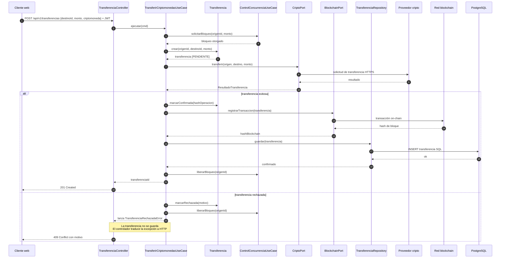

# Nivel 4 · Diagrama de código

> **Proyecto:** Flexcoin · **Módulos detallados:** Transferencias y Control de concurrencia  
> **Modelo:** C4 · Nivel 4 de 4 · **Notación:** UML · **Versión:** 1.0

---

## 1. Objetivo

Mostrar **cómo está organizado el código** de un componente del nivel 3: sus clases, interfaces y la forma en que colaboran. Se detalla el flujo **Transferir criptomonedas**, que involucra a los módulos **Transferencias** y **Control de concurrencia**, y a la integración con el proveedor de criptomonedas y la red blockchain.

| Aspecto | Descripción |
|---|---|
| Pregunta que responde | ¿Qué clases existen dentro de un módulo y cómo se relacionan? |
| Audiencia | Desarrolladores |
| Notación | UML (diagrama de clases y diagrama de secuencia). El modelo C4 recomienda UML para este nivel |
| Por qué estos dos módulos | El nivel 4 se dibuja para los componentes más importantes o complejos. Transferencias y Control de concurrencia concentran las reglas críticas de Flexcoin y las integraciones externas |
| Nivel anterior | `Nivel3-Diagrama-de-Componentes.md` |

---

## 2. Diagrama de clases

```mermaid
classDiagram
    %% MÓDULO TRANSFERENCIAS
    class TransferenciaController {
        - transferir: TransferirCriptomonedasUseCase
        + transferir(req, res): Promise~void~
    }

    class TransferirCriptomonedasUseCase {
        - transferenciaRepo: TransferenciaRepository
        - controlConcurrencia: ControlConcurrenciaUseCase
        - criptoPort: CriptoPort
        - blockchainPort: BlockchainPort
        + ejecutar(cmd): Promise~string~
    }

    class Transferencia {
        - id: string
        - origenId: string
        - destinoId: string
        - monto: MontoTransferencia
        - estado: EstadoTransferencia
        - hashBlockchain: string
        + crear(origenId, destinoId, monto): Transferencia
        + marcarConfirmada(hash): void
        + marcarRechazada(motivo): void
    }

    class MontoTransferencia {
        + valor: number
        + criptomoneda: string
        + validar(): void
    }

    class EstadoTransferencia {
        <<enumeration>>
        PENDIENTE
        CONFIRMADA
        RECHAZADA
        CANCELADA
    }

    class TransferenciaRepository {
        <<interface>>
        + guardar(transferencia): Promise~void~
        + buscarPorId(id): Promise~Transferencia~
    }

    class CriptoPort {
        <<interface>>
        + transferir(origen, destino, monto): Promise~ResultadoTransferencia~
    }

    class BlockchainPort {
        <<interface>>
        + registrarTransaccion(transferencia): Promise~string~
    }

    class ResultadoTransferencia {
        + exitoso: boolean
        + hashOperacion: string
        + motivoRechazo: string
    }

    class PostgresTransferenciaRepository {
        - db: Pool
        + guardar(transferencia): Promise~void~
        + buscarPorId(id): Promise~Transferencia~
    }

    class BinanceCriptoAdapter {
        - cliente: SDK
        + transferir(origen, destino, monto): Promise~ResultadoTransferencia~
    }

    class BlockchainAdapter {
        - cliente: SDK
        + registrarTransaccion(transferencia): Promise~string~
    }

    %% MÓDULO CONTROL DE CONCURRENCIA
    class ControlConcurrenciaUseCase {
        <<API pública del módulo>>
        - controlPort: ControlConcurrenciaPort
        + solicitarBloqueo(recursoId, monto): Promise~void~
        + liberarBloqueo(recursoId): Promise~void~
    }

    class ControlConcurrenciaPort {
        <<interface>>
        + bloquear(recursoId): Promise~void~
        + liberar(recursoId): Promise~void~
    }

    class InMemoryLockAdapter {
        - bloqueados: Map
        + bloquear(recursoId): Promise~void~
        + liberar(recursoId): Promise~void~
    }

    %% RELACIONES
    TransferenciaController --> TransferirCriptomonedasUseCase : usa
    TransferirCriptomonedasUseCase ..> Transferencia : crea
    TransferirCriptomonedasUseCase --> TransferenciaRepository : usa
    TransferirCriptomonedasUseCase --> CriptoPort : usa
    TransferirCriptomonedasUseCase --> BlockchainPort : usa
    TransferirCriptomonedasUseCase --> ControlConcurrenciaUseCase : usa API pública

    Transferencia *-- MontoTransferencia
    Transferencia --> EstadoTransferencia

    PostgresTransferenciaRepository ..|> TransferenciaRepository
    BinanceCriptoAdapter ..|> CriptoPort
    BlockchainAdapter ..|> BlockchainPort
    CriptoPort ..> ResultadoTransferencia : retorna

    ControlConcurrenciaUseCase --> ControlConcurrenciaPort : usa
    InMemoryLockAdapter ..|> ControlConcurrenciaPort
```

### 2.1 Capas de Clean Architecture

| Capa | Contiene | Regla |
|---|---|---|
| **Presentación** | Controladores | Traduce HTTP a llamadas del caso de uso y viceversa |
| **Aplicación** | Casos de uso | Coordina los pasos del proceso; no conoce la tecnología |
| **Dominio** | Entidades, objetos de valor, interfaces | Contiene las reglas del negocio; no importa nada de las otras capas |
| **Infraestructura** | Repositorios y adaptadores | Implementa las interfaces del dominio con una tecnología concreta |

> **Regla de dependencia:** las flechas del código apuntan hacia el dominio. Las clases de infraestructura implementan interfaces del dominio (triángulo hueco); el dominio nunca conoce a la infraestructura.

### 2.2 Clases del módulo Transferencias

| Clase | Tipo | Capa | Responsabilidad |
|---|---|---|---|
| `TransferenciaController` | Controlador | Presentación | Recibe `POST /api/v1/transferencias` y responde al cliente |
| `TransferirCriptomonedasUseCase` | Caso de uso | Aplicación | Crea la transferencia, solicita el bloqueo, ejecuta el envío de criptos, registra on-chain y guarda |
| `Transferencia` | Entidad | Dominio | Valida la transferencia, controla sus estados y guarda el hash de la blockchain |
| `MontoTransferencia` | Objeto de valor | Dominio | Monto y criptomoneda con validación propia |
| `EstadoTransferencia` | Enumeración | Dominio | PENDIENTE, CONFIRMADA, RECHAZADA, CANCELADA |
| `TransferenciaRepository` | Interfaz | Dominio | Contrato para guardar y buscar transferencias |
| `CriptoPort` | Interfaz | Dominio | Contrato para ejecutar la transferencia en el proveedor de criptomonedas |
| `BlockchainPort` | Interfaz | Dominio | Contrato para registrar la transacción on-chain |
| `PostgresTransferenciaRepository` | Repositorio | Infraestructura | Implementa `TransferenciaRepository` con PostgreSQL |
| `BinanceCriptoAdapter` | Adaptador | Infraestructura | Implementa `CriptoPort` llamando a la API del proveedor |
| `BlockchainAdapter` | Adaptador | Infraestructura | Implementa `BlockchainPort` enviando la transacción a la red |

### 2.3 Clases del módulo Control de concurrencia

| Clase | Tipo | Capa | Responsabilidad |
|---|---|---|---|
| `ControlConcurrenciaUseCase` | Caso de uso (API pública) | Aplicación | Único punto por el que otros módulos solicitan bloqueo sobre un saldo |
| `ControlConcurrenciaPort` | Interfaz | Dominio | Contrato para bloquear y liberar un recurso |
| `InMemoryLockAdapter` | Adaptador | Infraestructura | Implementa el bloqueo en memoria dentro del proceso del monolito |

### 2.4 Notación UML utilizada

| Símbolo | Significado | Ejemplo |
|---|---|---|
| Línea continua con flecha abierta | Asociación: la clase tiene una referencia a la otra | `TransferirCriptomonedasUseCase` → `TransferenciaRepository` |
| Línea discontinua con flecha abierta | Dependencia: la usa o la crea | `TransferirCriptomonedasUseCase` «crea» `Transferencia` |
| Línea discontinua con triángulo hueco | Realización: implementa una interfaz | `PostgresTransferenciaRepository` ▷ `TransferenciaRepository` |
| Rombo relleno | Composición: la parte no existe sin el todo | `Transferencia` ◆ `MontoTransferencia` |
| Nombre en cursiva con «interface» | Interfaz | `CriptoPort`, `BlockchainPort` |
| `-` y `+` | Atributo o método privado y público | `- estado`, `+ marcarConfirmada()` |

---

## 3. Diagrama de secuencia: transferir criptomonedas

| Paso | Origen a destino | Acción |
|---|---|---|
| 1 | Cliente web a `TransferenciaController` | Envía `POST /api/v1/transferencias` con destino, monto, criptomoneda y JWT |
| 2 | `TransferenciaController` a `TransferirCriptomonedasUseCase` | Ejecuta el caso de uso |
| 3 | Caso de uso a `ControlConcurrenciaUseCase` | Solicita bloqueo del saldo de origen |
| 4 | Caso de uso a `Transferencia` | Crea la transferencia en estado PENDIENTE |
| 5 | Caso de uso a `CriptoPort` | Solicita la transferencia al proveedor |
| 6 | `BinanceCriptoAdapter` a proveedor externo | Envía la solicitud por HTTPS |
| 7 | Caso de uso a `Transferencia` | Si fue exitosa, la marca como CONFIRMADA |
| 8 | Caso de uso a `BlockchainPort` | Registra la transacción on-chain |
| 9 | `BlockchainAdapter` a red blockchain | Envía la transacción a la red |
| 10 | Caso de uso a `TransferenciaRepository` | Guarda la transferencia |
| 11 | `PostgresTransferenciaRepository` a PostgreSQL | Ejecuta el `INSERT` |
| 12 | Caso de uso a `ControlConcurrenciaUseCase` | Libera el bloqueo del saldo |
| 13 | `TransferenciaController` a cliente web | Responde `201 Created` con el identificador |
| 14 | Alternativa | Si la transferencia es rechazada, se libera el bloqueo, no se guarda y se responde `409 Conflict` |

---

## 4. Patrones y principios que se ven en este nivel

| Elemento del diagrama | Patrón o principio |
|---|---|
| `BinanceCriptoAdapter`, `BlockchainAdapter` | Patrón **Adapter** |
| `TransferenciaRepository` y `PostgresTransferenciaRepository` | Patrón **Repository** |
| `InMemoryLockAdapter` | Patrón **Strategy** aplicado al bloqueo (permite reemplazar la estrategia por Redis en el futuro) |
| El caso de uso recibe interfaces, no clases concretas | Principio de **inversión de dependencias** (SOLID) |
| Una clase por responsabilidad (controlador, caso de uso, entidad, repositorio) | Principio de **responsabilidad única** (SOLID) |
| Transferencias usa a Control de concurrencia solo mediante `ControlConcurrenciaUseCase` | Regla del **monolito modular**: comunicación por la API pública del módulo |

> Detalle completo en `03-diseño-de-software/diseño-interno/patrones-de-diseño.md` y `principios-de-diseño.md`.